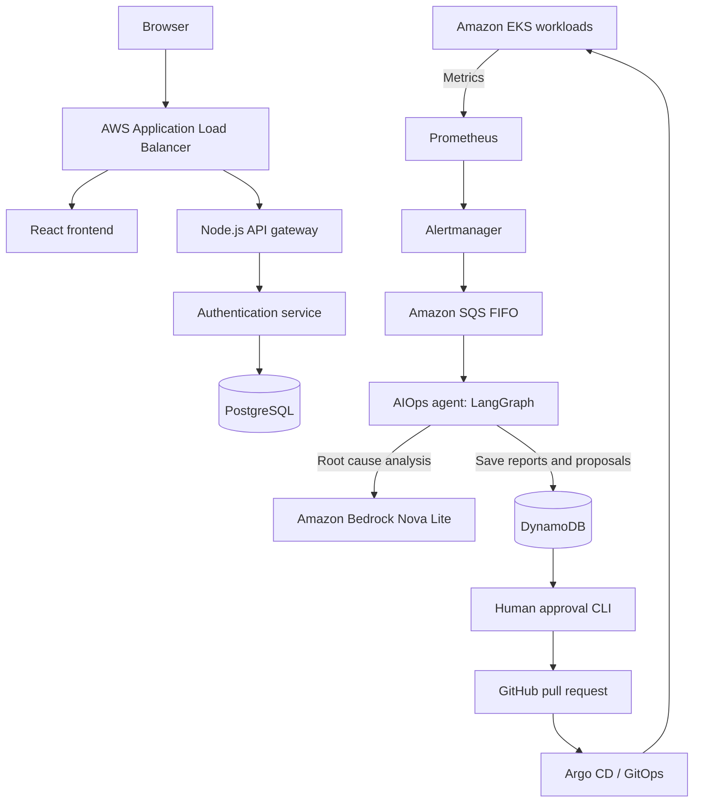

# Autonomous DevSecOps & Cloud Operations Platform

A hands-on DevOps and cloud engineering project built around a small e-commerce application on AWS. It combines infrastructure automation, CI/CD, Kubernetes monitoring, and an AI-assisted incident response workflow.

**The main idea:** when a Kubernetes workload fails, the platform gathers evidence and suggests a fix. A human must review and approve the proposed change before it can reach the cluster through GitOps.

**Project status:** The application was deployed and tested on AWS EKS in `us-east-2`. After collecting live evidence, the project-owned cloud infrastructure was intentionally deleted to limit costs. **The demo URLs are no longer live.** GitHub code, CI checks, screenshots, and terminal proofs remain available.

## What this project demonstrates

- **Cloud infrastructure:** Terraform provisioned the VPC, EKS Auto Mode cluster, networking, and supporting AWS services.
- **CI/CD:** GitHub Actions validated code, ran tests, scanned container images with Trivy, and previously published images to Amazon ECR.
- **GitOps:** Argo CD applied Kubernetes configuration from Git. Argo Rollouts was configured for a frontend canary release with 50% and 100% traffic steps.
- **Monitoring:** Prometheus and Alertmanager detected Kubernetes incidents; Grafana displayed cluster and application metrics.
- **AIOps:** A Python/LangGraph agent used Amazon Bedrock Nova Lite to help diagnose incidents and prepare bounded remediation proposals.
- **Human approval:** The operator reviewed the proposal and its YAML diff before the system opened a GitHub pull request. AI did not directly change the running cluster.
- **Recovery:** PostgreSQL backups were stored in S3 using AWS KMS encryption, and a separate restore test verified the saved data.

## Architecture

This diagram shows how the platform worked **while deployed**:

Terraform created the AWS infrastructure. GitHub Actions built and checked the application, while Argo CD managed the Kubernetes deployment from version-controlled manifests.

## Technology stack

| Area | Technologies | Why they were used |
| --- | --- | --- |
| Infrastructure | AWS, Terraform, VPC, EKS Auto Mode, S3 remote state | Create and track cloud resources as code |
| Application | React, Node.js/Express, PostgreSQL | Provide a real multi-service application to operate |
| CI/CD | GitHub Actions, Docker, ECR, Trivy | Build, test, scan, and publish container images |
| Delivery | Kubernetes, Kustomize, Argo CD, Argo Rollouts | Manage deployments through Git and configure canary releases |
| Monitoring | Prometheus, Alertmanager, Grafana | Collect metrics, send alerts, and view system health |
| AIOps | Python, LangGraph, Bedrock Nova Lite, SQS, DynamoDB | Analyze incidents and record proposed fixes |
| Security & backup | IAM, OIDC, KMS, Secrets Manager, S3, Ansible | Control access, protect secrets, and automate backups |

## Real incident: OOMKilled to an approved fix

The strongest end-to-end test used a **separate canary test workload** to reproduce an out-of-memory failure.

1. **Failure:** The canary ran with a `64Mi` memory request and `128Mi` limit. A controlled memory-load trigger caused a real `OOMKilled` termination (exit code `137`).
2. **Detection:** Prometheus identified the problem. Alertmanager routed the alert through an SQS FIFO queue.
3. **Diagnosis:** The AIOps agent collected relevant telemetry, sanitized it, called **Amazon Bedrock Nova Lite** (`amazon.nova-lite-v1:0`), and stored the root cause analysis and proposal in DynamoDB.
4. **Safety check:** The proposal went through a rule-based policy check and an operator approval process. The project also tested rejection of an earlier proposal.
5. **GitOps fix:** After the operator reviewed the diff and approved it, the system opened [remediation PR #2](https://github.com/itsme-aarjav/autonomous-devsecops-platform/pull/2). The change raised the canary's memory request from `64Mi` to `256Mi` and its limit from `128Mi` to `512Mi`.
6. **Verification:** The PR was merged, CI passed, and later live verification recorded a healthy canary with no restarts. The final values remain in [the production canary manifest](devops/gitops/overlays/production/canary.yml).

This is **human-approved remediation**, not an unrestricted AI system that modifies production on its own. The frontend's Argo Rollouts canary configuration is a separate feature from this OOMKilled test.

**Evidence:** [OOMKilled log](proof/terminal-outputs/09-aiops-oomkilled.txt) · [Human approval and PR](proof/terminal-outputs/30-aiops-human-approval-pr.txt) · [Merged PR #2](https://github.com/itsme-aarjav/autonomous-devsecops-platform/pull/2) · [Successful live pipeline](https://github.com/itsme-aarjav/autonomous-devsecops-platform/actions/runs/42529170045)

## CI/CD and security

The historical deployment flow was: **push code → validate and test → scan and build containers → publish to ECR → update GitOps manifests → verify deployment on EKS**.

The pipeline includes Terraform formatting, Ansible and shell syntax checks, Kustomize validation, **27 AIOps unit/security tests**, Trivy scanning, and builds for four container images. GitHub Actions used AWS OpenID Connect (OIDC) to obtain short-lived AWS credentials instead of storing permanent AWS access keys in the repository.

**After teardown:** The CI jobs still run, but ECR publishing and the EKS deployment job are disabled. See the [current GitHub Actions runs](https://github.com/itsme-aarjav/autonomous-devsecops-platform/actions) and [workflow configuration](.github/workflows/platform.yml).

## Backup and recovery

A scheduled job created a compressed PostgreSQL SQL backup at **2:00 AM IST** and stored it in S3 with AWS KMS encryption. In the live restore test, the backup was loaded into a temporary PostgreSQL pod, without connecting to the running application database. The test confirmed **five tables**, their row counts, and **eight catalog products**. The temporary pod was then removed.

The restore pod used normal cluster networking; the test did **not** demonstrate complete network isolation. A separate [EBS snapshot recovery test](proof/backup-recovery/restore-verification.md) is also documented.

**Evidence:** [S3 SQL backup and restore verification](proof/terminal-outputs/35-isolated-backup-restore-verification.txt)

## Screenshots and verification

These screenshots were captured during the live AWS deployment, **before the cloud resources were deleted**.

| Storefront | Argo CD |
| --- | --- |
|  |  |
| Grafana monitoring | AWS EKS |
|  |  |

- [All 28 screenshots, organized by category](proof/screenshots/README.md)
- [36 numbered verification stages across 38 terminal log files](proof/terminal-outputs/README.md)
- [AWS teardown evidence](proof/terminal-outputs/36-aws-teardown-and-cost-elimination.txt)
- [Complete proof index](proof/README.md)

## Repository layout

| Directory | What is inside |
| --- | --- |
| [`application/`](application/) | React frontend, API gateway, and authentication service |
| [`aiops/`](aiops/) | Incident analysis, policy checks, operator CLI, and tests |
| [`devops/terraform/`](devops/terraform/) | AWS infrastructure definitions and remote state configuration |
| [`devops/gitops/`](devops/gitops/) | Kubernetes manifests and Argo CD configuration |
| [`devops/`](devops/) | CI/CD support, Ansible, observability, and platform configuration |
| [`proof/`](proof/) | Screenshots, incident logs, backup tests, and teardown evidence |

For implementation details, start with the [AIOps README](aiops/README.md), [Terraform README](devops/terraform/README.md), [system architecture](proof/architecture/system-architecture.md), or [CI/CD explanation](proof/ci-cd/ci-cd-architecture.md).

## Current status and limits

- **Live verification completed:** EKS deployment, public HTTPS application, monitoring, AI-assisted diagnosis, human-approved PR, GitOps recovery, and database restore.
- **AWS demo decommissioned:** Project-owned resources were removed after testing. A small Terraform state bucket was retained. The estimated remaining **project-only** recurring AWS cost is **under $0.01/month**, pending AWS billing confirmation; unrelated older resources are excluded.
- **No live demo:** The historical application, Grafana, and Argo CD URLs should not be treated as active endpoints.
- **Scope:** This is a portfolio demonstration with controlled incidents and recorded evidence, not a claim of commercial production usage or measured service availability.

The code, Git history, [remediation PR](https://github.com/itsme-aarjav/autonomous-devsecops-platform/pull/2), and saved proofs show what was implemented and tested.
