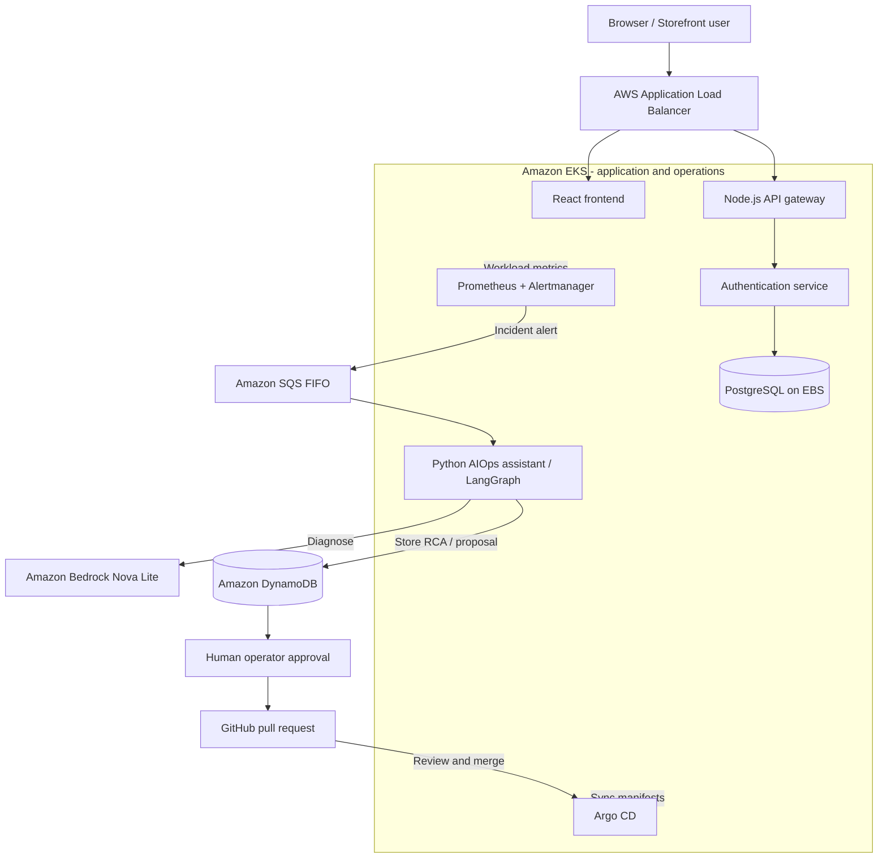
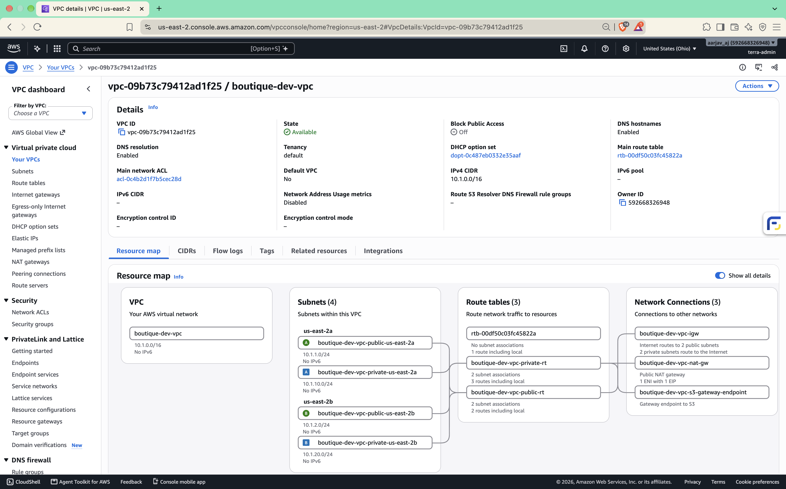
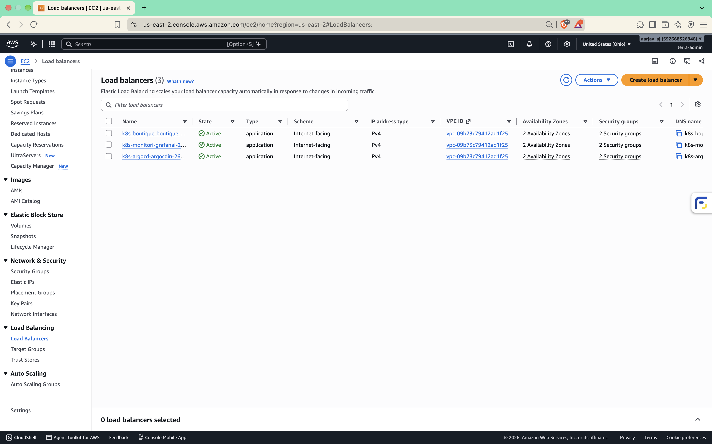

<div align="center">

# Autonomous DevSecOps & Cloud Operations Platform

### Infrastructure as Code · Kubernetes · GitOps · Observability · AI-assisted incident response

A hands-on AWS platform that **detects Kubernetes incidents, investigates their cause, and proposes GitOps fixes for human approval.**

[](https://github.com/itsme-aarjav/autonomous-devsecops-platform/actions/workflows/platform.yml)


[Architecture](#architecture) · [Tech Stack](#technology-stack) · [Real Incident](#real-incident-oomkilled-to-gitops-fix) · [Proof Gallery](#live-verification-gallery) · [Code & Documentation](#repository-guide)

</div>

> **Current status:** The full platform was deployed and verified on **Amazon EKS in us-east-2**. After testing, its project-owned AWS infrastructure was intentionally removed to control costs. The previous website, Argo CD, and Grafana URLs are **not live today**. Code, GitHub CI, and recorded proof remain available.

## Project overview

This project runs a small e-commerce application with a React storefront, Node.js API gateway, authentication service, and PostgreSQL database. The application gives the DevOps platform a real workload to deploy, monitor, and troubleshoot.

**The main challenge:** Monitoring can tell us that a container has failed, but finding the cause and making a safe change requires investigation and review.

**The solution:** Prometheus detects the problem; an AIOps assistant collects relevant information and uses Amazon Bedrock Nova Lite for root cause analysis. A policy engine checks the proposed fix. An authorized operator must approve it, after which a GitHub pull request can be reviewed and merged for Argo CD to apply.

### Key capabilities

| Capability | What was implemented |
| --- | --- |
| **Cloud provisioning** | Modular Terraform for VPC, EKS Auto Mode, IAM, ECR, S3, KMS, SQS, and DynamoDB |
| **CI/CD** | GitHub Actions validation, container builds, security scanning, and historical ECR publishing |
| **GitOps delivery** | Argo CD sync from Git and a separate Argo Rollouts frontend canary strategy |
| **Monitoring** | Prometheus metrics, Alertmanager routing, and Grafana dashboards |
| **AI-assisted operations** | LangGraph workflow with live Amazon Bedrock Nova Lite root cause analysis |
| **Safe remediation** | Allowlisted manifest changes, human approval CLI, reviewed GitHub PR |
| **Backup and recovery** | Scheduled PostgreSQL SQL backups to KMS-encrypted S3 and verified test restore |

## Technology stack

These technologies are used in the repository or were used in the verified AWS deployment. Logos are displayed as badges; detailed service responsibilities are described below.

### Cloud & infrastructure

         

AWS services provided the EKS cluster and its networking, container registry, incident queue, encrypted storage, and state databases. **Terraform** managed the infrastructure, while **Docker** packaged the application services.

### CI/CD, GitOps & automation

     

**GitHub Actions** checked the code and containers. **Argo CD** used Git as the source of Kubernetes configuration. **Argo Rollouts** supplied the frontend's staged rollout configuration; **Ansible** supported limited operational automation.

### Monitoring & AI operations

     

**Prometheus** collected metrics, **Alertmanager** routed alerts, and **Grafana** displayed dashboards. The **Python/LangGraph** assistant invoked **Amazon Bedrock Nova Lite** for structured diagnosis.

### Application & database

      

The storefront uses **React, TypeScript, and Vite**. The backend uses **Node.js/Express** for the API gateway and authentication service, with **PostgreSQL** for application data.

## Architecture

This diagram describes the **previously deployed** system. The monitoring and incident-remediation path is separate from the customer-facing application.



**How the pieces fit together:**

1. Terraform provisioned AWS infrastructure; EKS ran the containers.
2. GitHub Actions built and checked changes. During live operation, images were pushed to ECR and Kubernetes manifests were updated through GitOps.
3. Prometheus and Grafana showed workload health. Alertmanager reported issues.
4. The AIOps assistant diagnosed incidents and stored reports and proposals in DynamoDB.
5. The operator reviewed proposed manifest changes. A merged GitHub PR allowed Argo CD to synchronize the fix.

[Detailed system architecture](proof/architecture/system-architecture.md) · [AIOps pipeline](proof/architecture/aiops-pipeline.md) · [Terraform structure](devops/terraform/README.md)

## Real incident: OOMKilled to GitOps fix

**This was tested on the live AWS cluster**, not just through unit-test mocks. A separate canary test workload was used, so the failure did not need to be injected into the storefront.

| Stage | What happened | Evidence |
| --- | --- | --- |
| **1. Trigger** | Controlled memory pressure caused the test canary to terminate with **OOMKilled (exit code 137)**. | [Pod log](proof/terminal-outputs/09-aiops-oomkilled.txt) |
| **2. Detect** | Prometheus raised an alert; Alertmanager routed it through SQS FIFO. | [Alert](proof/terminal-outputs/11-prometheus-oom-alert.txt) · [Routing](proof/terminal-outputs/12-alertmanager-incident.txt) |
| **3. Diagnose** | LangGraph collected and sanitized evidence; **Bedrock Nova Lite** generated an RCA and DynamoDB stored the proposal. | [AIOps processing](proof/terminal-outputs/13-aiops-processing.txt) · [Proposal](proof/terminal-outputs/14-aiops-dynamodb-proposal.txt) |
| **4. Review** | An earlier proposal was rejected. A later, policy-approved proposal was inspected and approved by an authenticated operator. | [Rejection](proof/terminal-outputs/17-aiops-human-rejection.txt) · [Approval](proof/terminal-outputs/30-aiops-human-approval-pr.txt) |
| **5. Change** | The approved change opened **GitHub PR #2**, which was reviewed and merged. | [Remediation PR #2](https://github.com/itsme-aarjav/autonomous-devsecops-platform/pull/2) |
| **6. Verify** | Later configuration and operational checks recorded the higher memory settings after the GitOps change. | [Final manifest](devops/gitops/overlays/production/canary.yml) · [Live CI run](https://github.com/itsme-aarjav/autonomous-devsecops-platform/actions/runs/42529170045) |

### The actual memory change

| Canary setting | Before | After approval |
| --- | ---: | ---: |
| Memory request | `64Mi` | **`256Mi`** |
| Memory limit | `128Mi` | **`512Mi`** |

**Why human approval matters:** The AI model helped identify a problem, but it was **not allowed to directly change Kubernetes workloads**. The fix was constrained by a policy check, then passed through operator approval, a GitHub PR, and GitOps reconciliation.

The frontend's **Argo Rollouts** strategy is separate from this OOMKilled test. Its production configuration uses **50% → 100%** traffic steps with a pause, as shown in [`frontend.yml`](devops/gitops/overlays/production/frontend.yml).

## CI/CD and deployment

The historical release process was:

```text
Code push / pull request
       |
       v
Terraform, Ansible, shell and Kustomize checks
       |
       v
AIOps tests + Trivy filesystem scan
       |
       v
Build and scan four Docker images
       |
       v
ECR publish -> GitOps image update -> Argo CD sync -> EKS verification
                     (historical live deployment only)
```

**Four container images:** `boutique-frontend`, `boutique-gateway`, `boutique-auth`, and `boutique-aiops-assistant`.

The pipeline uses Trivy for security scans and GitHub OIDC for short-lived AWS credentials during its historical deployment path. **After teardown**, validation and image-build checks still run, but **ECR publishing and EKS deployment are disabled** so routine pushes do not recreate cloud resources.

[Current GitHub Actions](https://github.com/itsme-aarjav/autonomous-devsecops-platform/actions) · [Successful historical deployment](https://github.com/itsme-aarjav/autonomous-devsecops-platform/actions/runs/42529170045) · [CI/CD explanation](proof/ci-cd/ci-cd-architecture.md)

## Security, backups & recovery

| Area | Implementation |
| --- | --- |
| **AWS authentication** | GitHub OIDC and IAM roles instead of storing permanent AWS access keys in Actions |
| **Secrets** | AWS Secrets Manager and Kubernetes Secrets for application credentials |
| **Encryption** | AWS KMS used with project data services and S3 PostgreSQL backups |
| **Container checks** | Trivy scanning; non-root containers and restrictive settings where configured |
| **Remediation safety** | Policy-based allowlist, operator identity checks, HMAC token verification, and PR review |
| **Database recovery** | A Kubernetes CronJob used `pg_dump` and uploaded compressed SQL files to S3 at **2:00 AM IST** |

**Backup test result:** An S3 SQL archive was restored into a temporary PostgreSQL pod. The test checked **five tables**, their row counts, and **eight product records**. The pod was removed after testing. This was an isolated **test database**, not a claim of network air-gapping. An EBS snapshot recovery test was documented separately.

[SQL restore terminal proof](proof/terminal-outputs/35-isolated-backup-restore-verification.txt) · [Backup design](proof/backup-recovery/s3-daily-backup.md) · [EBS restore record](proof/backup-recovery/restore-verification.md) · [Security details](proof/security/security-architecture.md)

## Live verification gallery

All screenshots below were captured **while the AWS environment was running**, before the teardown.

| Storefront | Argo CD / GitOps |
| :---: | :---: |
| [](proof/architecture/01-storefront-ui-demo.png) | [](proof/ci-cd/02-argocd-application-overview.png) |
| **Grafana monitoring** | **Amazon EKS** |
| [](proof/monitoring/04-grafana-cluster-compute-resources.png) | [](proof/kubernetes/20-aws-eks-cluster-info.png) |
| **AWS VPC** | **Load balancers** |
| [](proof/architecture/19-aws-vpc-resource-map.png) | [](proof/architecture/22-aws-alb-load-balancers.png) |

### Evidence you can inspect

| Evidence set | Contents |
| --- | --- |
| [Screenshot index](proof/screenshots/README.md) | **28** screenshots grouped into architecture, CI/CD, Kubernetes, monitoring, backup, and security |
| [Terminal log index](proof/terminal-outputs/README.md) | **36** numbered stages captured in **38** terminal files |
| [AIOps incident chain](proof/demo-guide.md) | A quick path through detection, diagnosis, approval and recovery |
| [Merged remediation PR](https://github.com/itsme-aarjav/autonomous-devsecops-platform/pull/2) | Real proposed YAML change and merge record |
| [Teardown evidence](proof/terminal-outputs/36-aws-teardown-and-cost-elimination.txt) | Recorded deletion of project-owned AWS infrastructure |

## Repository guide

```text
autonomous-devsecops-platform/
├── application/               React frontend + Node.js backend services
├── aiops/                     LangGraph agent, remediation policy, operator CLI
├── devops/
│   ├── terraform/             AWS infrastructure and state configuration
│   ├── gitops/                Kubernetes manifests and Argo CD
│   ├── ansible/               Supporting operational automation
│   └── observability/         Monitoring configuration
├── .github/workflows/         CI and historical cloud-deployment workflow
└── proof/                     Screenshots, logs, recovery and teardown records
```

### Technical documentation

| Read this | To understand |
| --- | --- |
| [AIOps README](aiops/README.md) | LangGraph steps, Bedrock, policies and human approval |
| [Terraform README](devops/terraform/README.md) | Cloud infrastructure roots, S3 state and teardown |
| [System architecture](proof/architecture/system-architecture.md) | Networking and component connections |
| [CI/CD architecture](proof/ci-cd/ci-cd-architecture.md) | Validation, build, scanning and GitOps |
| [Monitoring](proof/monitoring/observability-stack.md) | Prometheus, Alertmanager and Grafana |
| [Security](proof/security/security-architecture.md) | IAM, OIDC, encryption and approvals |
| [Proof index](proof/README.md) | All visual and terminal verification |

## Local checks

These commands validate parts of the repository **without creating AWS infrastructure**. Install their normal dependencies first.

```bash
# From repository root: AIOps unit and security tests
python3 -m unittest discover -s aiops/tests -p "test_*.py" -v

# Terraform formatting (no apply)
terraform fmt -recursive -check devops/terraform

# Kubernetes manifest rendering (no deploy)
kubectl kustomize devops/gitops/overlays/production

# Frontend production build
cd application/frontend
npm ci
npm run build
```

The local test suite and manifest checks are **not substitutes** for the saved live AWS evidence.

## Current project status

| Item | Status |
| --- | --- |
| AWS deployment and live incident verification | **Completed historically** |
| Human-approved GitOps remediation | **Verified with PR #2** |
| PostgreSQL backup and test restore | **Verified** |
| Screenshots and terminal proofs | **Preserved in GitHub** |
| GitHub CI validation and security checks | **Remain enabled** |
| ECR publishing and cloud deployment | **Disabled after teardown** |
| Project-owned AWS infrastructure | **Intentionally decommissioned** |

The remaining project-owned S3 Terraform state bucket is estimated to cost **less than $0.01 per month**, pending confirmation from AWS billing. Older, unrelated AWS resources are excluded. Historical usage charges may still appear on the account invoice.

**Scope:** This is a personal, hands-on portfolio project with controlled incident testing. It does not claim real customer traffic, commercial production availability, or a continuously running public demo.

---

<div align="center">

**Built as a practical DevOps, Cloud, SRE and Platform Engineering learning project.**

[View GitHub Actions](https://github.com/itsme-aarjav/autonomous-devsecops-platform/actions) · [Explore the proof package](proof/README.md) · [See the remediation pull request](https://github.com/itsme-aarjav/autonomous-devsecops-platform/pull/2)

</div>