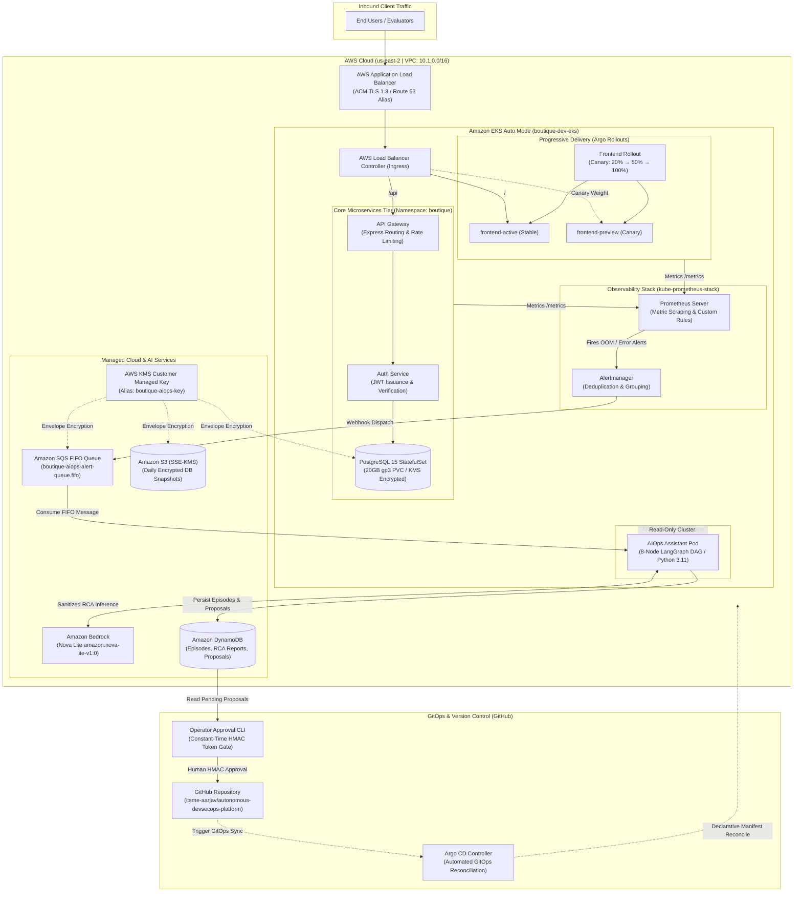
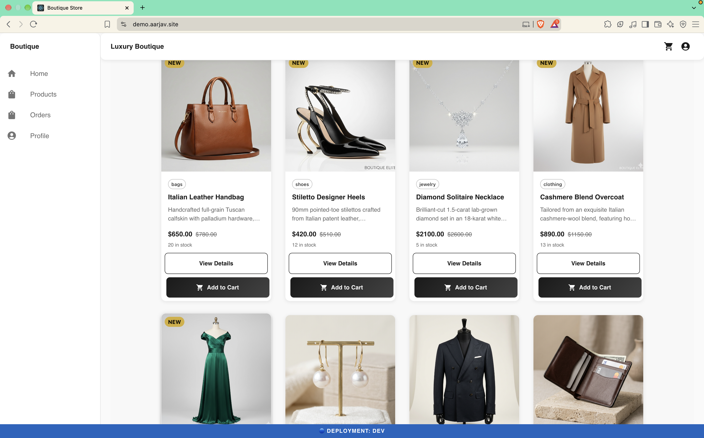
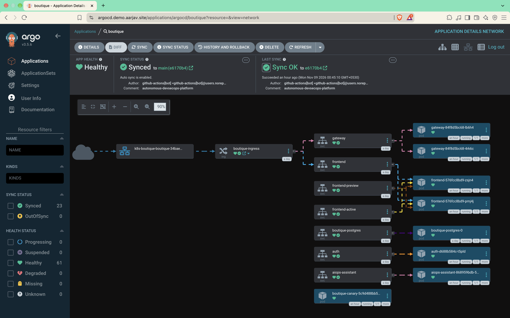
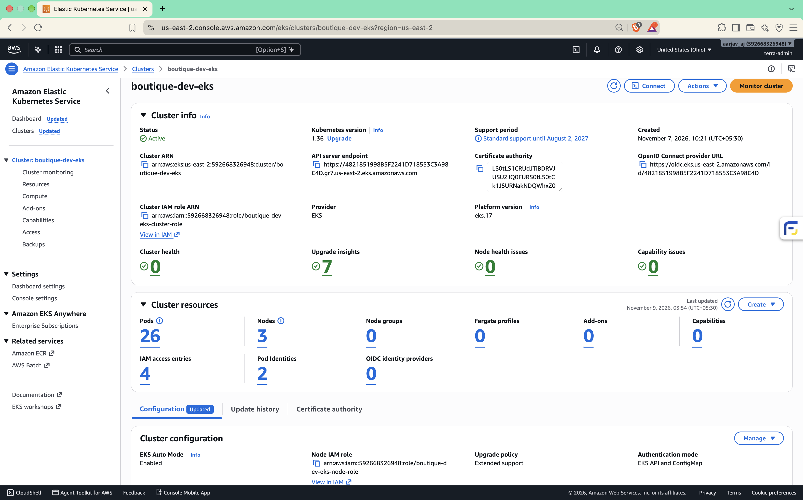

# Autonomous DevSecOps & Cloud Operations Platform

[](https://github.com/itsme-aarjav/autonomous-devsecops-platform/actions/workflows/platform.yml)
[](https://kubernetes.io/)
[](https://argo-cd.readthedocs.io/)
[](https://argoproj.github.io/argo-rollouts/)
[](https://www.terraform.io/)
[](https://aws.amazon.com/bedrock/)
[](https://prometheus.io/)
[](https://www.postgresql.org/)

An enterprise-grade, cloud-native **Autonomous DevSecOps and Platform Engineering platform** featuring a **3-Tier Microservices Architecture**, declarative GitOps with **Argo CD**, zero-downtime **Progressive Canary Delivery** via **Argo Rollouts**, full-stack telemetry using **Prometheus & Grafana**, and an event-driven **AIOps SRE Agent (LangGraph + Amazon Bedrock Nova Lite)** with **Human-Approved GitOps Self-Healing**:
1. **Automated Incident Root Cause Diagnosis**: An in-cluster diagnostic agent consumes deduplicated Alertmanager alerts via SQS FIFO, gathers read-only cluster telemetry, sanitizes sensitive tokens, and executes structured root cause analysis via Amazon Bedrock Nova Lite (`amazon.nova-lite-v1:0`).
2. **Human-in-the-Loop GitOps Remediation**: Proposes surgical YAML manifest patches evaluated against strict deterministic policy bounds. A cloud operator reviews proposals via a secure CLI (`aiops/operator_cli.py`), authenticates using constant-time HMAC tokens (`hmac.compare_digest`), and approves patches that automatically open reviewed GitHub Pull Requests for human merge and declarative Argo CD reconciliation.

---

> [!NOTE]
> **Live Deployment & Verification Status**:
> - **Real AWS Deployment**: The platform was deployed live in AWS account `592668326948` (`us-east-2`) on Amazon EKS Auto Mode (`boutique-dev-eks`) with public HTTPS routing via Route 53 and AWS ALB at `https://demo.aarjav.site`.
> - **Operational Verification**: Completed full 16-step operational testing, including live e-commerce transactions, Prometheus OOMKilled alert dispatch, Bedrock Nova Lite RCA generation, operator CLI approval/rejection, reviewed GitHub PR creation, GitOps sync, and an isolated KMS-encrypted PostgreSQL database restore.
> - **Cost Governance Decommissioning**: Following complete verification, all active cloud resources were intentionally decommissioned to eliminate ongoing cloud spend ($0.00/mo ongoing cost).
> - **Permanent Proof Package**: All 28 live high-resolution screenshots and 36 terminal execution logs are preserved in [`proof/screenshots/`](proof/screenshots/) and [`proof/terminal-outputs/`](proof/terminal-outputs/).

---

## 1. High-Level Architecture



---

## 2. Visual Proof Gallery

The platform's live operation was fully captured prior to cloud decommissioning. Below are key visual proofs from the [28-screenshot catalog](proof/screenshots/README.md):

| Storefront UI (`demo.aarjav.site`) | Argo CD GitOps Application Topology |
| :---: | :---: |
| [](proof/screenshots/01-storefront-ui-demo.png) | [](proof/screenshots/03-argocd-network-topology.png) |
| *8 seeded luxury products with real USD pricing & cart* | *Declarative ALB Ingress &rarr; Service &rarr; Pod tree* |

| Grafana Cluster Compute Metrics | AWS EKS Cluster Console |
| :---: | :---: |
| [](proof/screenshots/04-grafana-cluster-compute-resources.png) | [](proof/screenshots/20-aws-eks-cluster-info.png) |
| *Real-time CPU (2.74%), RAM (20.5%), 0 packet drops* | *Active EKS cluster, k8s v1.36, 26 pods, 3 nodes* |

| AWS VPC Resource Map | AWS Application Load Balancers |
| :---: | :---: |
| [](proof/screenshots/19-aws-vpc-resource-map.png) | [](proof/screenshots/22-aws-alb-load-balancers.png) |
| *2 public + 2 private subnets across 2 AZs, NAT GW, IGW* | *3 active ALBs for Storefront, Argo CD, and Grafana* |

---

## 3. Core Technical Capabilities

### A. 3-Tier Cloud-Native Microservices
- **Frontend (`frontend`)**: React 19 single-page application built on Node.js 24 LTS, packaged as a lightweight, hardened container running under non-root UID 10001.
- **API Gateway (`gateway`)**: Express reverse proxy handling path routing, rate limiting, and request sanitization.
- **Authentication Service (`auth`)**: Issues and validates cryptographically signed JWTs, managing password hashing (`bcrypt`) and user sessions.
- **Database (`boutique-postgres`)**: PostgreSQL 15.19 StatefulSet backed by a 20GB AWS EBS `gp3` volume with KMS envelope encryption.

### B. Declarative GitOps & Progressive Delivery
- **Argo CD**: Master GitOps operator continuously synchronizing Kubernetes manifests from `devops/gitops/` into the EKS cluster, eliminating configuration drift.
- **Argo Rollouts**: Zero-downtime canary progressive delivery:
  - `Step 1`: Shift **20%** of inbound traffic to `frontend-preview`; pause for health analysis.
  - `Step 2`: Shift **50%** of traffic to canary; verify error rates and latency.
  - `Step 3`: Promote to **100%** cutover on `frontend-active`.

### C. Full-Stack Observability & Telemetry
- **Prometheus Operator**: Custom `ServiceMonitor` definitions scraping application metrics, cgroup utilization, and cluster resource quotas.
- **Node Exporter**: Host-level telemetry on EKS Bottlerocket worker nodes (CPU, RAM, ENI packet rates, disk IOPS).
- **Alertmanager**: Deduplication and alert grouping engine routing actionable alerts to SQS FIFO.

### D. In-Cluster AIOps Assistant (LangGraph + Amazon Bedrock)
An autonomous diagnostic agent built as an **8-node LangGraph DAG**:
```
validate_input → normalize_incident → collect_evidence → sanitize_evidence → analyze_with_llm → validate_rca → propose_remediation → persist_result
```
- **Read-Only Telemetry Gathering**: Collects pod events, recent container logs, and PromQL metric rates without cluster write privileges.
- **Safety & Prompt Sanitization**: Redacts JWTs, database connection strings, bearer tokens, and private keys prior to LLM inference.
- **Inference with Amazon Bedrock Nova Lite**: Uses `amazon.nova-lite-v1:0` for low-latency, cost-effective structured root cause analysis.
- **Deterministic Policy Engine**: Enforces strict allowlists (e.g., container memory limit adjustments up to bounded thresholds) and rejects destructive commands (`rm -rf`, `DROP TABLE`, pod deletion loops).

### E. Human-in-the-Loop GitOps Self-Healing
```
Incident Detected (Pod OOMKilled)
       │
       ▼
Prometheus Alert &rarr; Alertmanager &rarr; SQS FIFO Queue
       │
       ▼
AIOps LangGraph Agent (Amazon Bedrock Nova Lite RCA)
       │
       ▼
Deterministic Policy Engine & DynamoDB Proposal Storage
       │
       ▼
Cloud Operator CLI Review (`aiops/operator_cli.py list / show`)
       │
       ▼
Constant-Time HMAC Token Approval (`aiops/operator_cli.py approve`)
       │
       ▼
Reviewed GitHub Pull Request Opened (`fix/aiops-proposal-<id>`)
       │
       ▼
Human Code Review & Merge into `main`
       │
       ▼
Argo CD Automatic Synchronization & Cluster Recovery
```
- **Constant-Time HMAC Token Gate**: The approval CLI validates operator identity using `hmac.compare_digest` against authorized credentials, preventing timing attacks.
- **Reviewed Pull Request Policy**: The platform never performs direct writes to `main`. Every remediation is staged as a pull request with full audit provenance (Incident ID, Episode ID, diagnosis, diff).

### F. Disaster Recovery & DevSecOps Hardening
- **Automated S3 Backups**: Two-stage Kubernetes CronJob executing daily compressed PostgreSQL backups encrypted with AWS KMS CMK `1e4e2ce3-e642-47a9-a20d-3a47b052918b`.
- **Isolated Point-in-Time Restore**: Verified end-to-end database restoration of snapshot `snap-05a3b0ffe3463e280` inside an ephemeral, network-isolated pod (verified schema, 8 products catalog, customer records).
- **Zero Static AWS Keys**: GitHub Actions authenticates to AWS exclusively through OpenID Connect (OIDC) federation.
- **Trivy Vulnerability Scanning**: Automated vulnerability scans on filesystem and multi-stage container images in CI.

---

## 4. The 16-Step Verification Evidence Chain

The platform was thoroughly verified on live cloud infrastructure across 16 sequential operational milestones, cataloged in [`proof/terminal-outputs/`](proof/terminal-outputs/):

```
[01-06] Baseline Health: CI/CD clean 10/10 → EKS active → 26 pods running → Public HTTPS 200 OK
   │
[07-10] Incident Injection: Safety preflight → Canary memory stress triggered → Pod OOMKilled (Exit 137)
   │
[11-15] Diagnosis & Persistence: Prometheus alert → Alertmanager webhook → SQS FIFO → Bedrock RCA → DynamoDB
   │
[16-18] Operator Rejection Flow: Operator inspects proposal in CLI → Exercises rejection with audit log
   │
[19-24] Renderer Verification: Manifest patcher validated locally → 27/27 unit tests green → CI verified
   │
[25-31] Operator Approval Flow: Fresh incident triggered → Operator verifies diff → HMAC approved → PR opened
   │
[32-34] GitOps Recovery: PR merged to main → Argo CD automatically reconciles → Cluster health restored
   │
[35-36] Recovery & Cost Governance: KMS DB restore verified → Infrastructure decommissioned (< $0.01/mo)
```

---

## 5. ATS Resume Bullets (DevOps / Cloud / SRE / Platform Engineer)

Copy-paste ready bullet points optimized for Applicant Tracking Systems (ATS) and tech recruiters:

- **Architected and deployed a cloud-native DevSecOps platform on AWS EKS (Kubernetes 1.36)** using 3-layer modular Terraform, provisioning VPC networking, ALB ingress, Bottlerocket nodes, and AWS KMS envelope encryption.
- **Implemented declarative GitOps and progressive delivery using Argo CD and Argo Rollouts**, enabling zero-downtime canary deployments (20% &rarr; 50% &rarr; 100% traffic shifting) with automated rollback safeguards.
- **Engineered an event-driven AIOps self-healing pipeline** using Prometheus, Alertmanager, SQS FIFO, and an 8-node LangGraph DAG integrated with Amazon Bedrock Nova Lite (`amazon.nova-lite-v1:0`) for automated root cause analysis.
- **Built a secure Human-in-the-Loop GitOps remediation engine** with constant-time HMAC token authentication (`hmac.compare_digest`), generating reviewed GitHub Pull Requests for operator-approved declarative manifest patching.
- **Configured full-stack observability and automated disaster recovery**, deploying Prometheus Operator, Grafana dashboards, and daily KMS-encrypted PostgreSQL S3 backups with verified point-in-time restoration.

---

## 6. Interview Preparation & Technical Defense

### The 30-Second Elevator Pitch
> *"I designed and built an Autonomous DevSecOps and Platform Engineering platform on AWS EKS. It runs a 3-tier microservices e-commerce application with declarative GitOps via Argo CD and canary rollouts via Argo Rollouts.
> 
> What makes the project unique is its autonomous SRE incident recovery engine: when Prometheus detects an issue like a Pod OOMKilled, an in-cluster LangGraph agent sanitizes telemetry and queries Amazon Bedrock Nova Lite for root cause analysis.
> 
> Rather than letting AI blindly modify production, I implemented a Human-in-the-Loop GitOps approval CLI secured with constant-time HMAC tokens. Once an operator approves the proposal, it automatically opens a reviewed GitHub Pull Request, which syncs through Argo CD upon merge."*

### The 2-Minute Architecture Walkthrough
1. **Infrastructure Foundation**: Provisioned via Terraform across 3 modular layers (Bootstrap S3 state, Persistent KMS/ECR/DynamoDB/SQS, and Production VPC/EKS). Runs on EKS Auto Mode with Bottlerocket worker nodes across 2 Availability Zones.
2. **Application & Progressive Delivery**: 3-tier microservices (React 19, Express Gateway, Auth JWT service, PostgreSQL 15 StatefulSet). Traffic enters through AWS ALB with ACM TLS. Argo Rollouts manages canary traffic shifting (20% &rarr; 50% &rarr; 100%).
3. **Observability**: Prometheus Operator scrapes cgroup metrics and custom ServiceMonitors. Preconfigured Alertmanager rules detect memory saturation, CrashLoopBackOff, and HTTP 5xx spikes.
4. **Autonomous AIOps Engine**: Alertmanager sends alerts to an encrypted AWS SQS FIFO queue for deduplication. A FastAPI agent executes an 8-node LangGraph DAG that collects read-only telemetry, sanitizes secrets, and invokes Amazon Bedrock Nova Lite.
5. **Remediation & Governance**: Proposals are bounded by a deterministic policy engine and persisted to DynamoDB. Operators use the `operator_cli.py` to inspect diffs and approve fixes via HMAC bearer tokens, opening a reviewed Pull Request that Argo CD reconciles. Post-verification, cloud resources were cleanly decommissioned to ensure zero ongoing cloud spend.

### Technical Deep-Dive Q&A

<details>
<summary><strong>Q1: Why did you choose Amazon Bedrock Nova Lite instead of a general commercial LLM like Claude 3.5 Sonnet?</strong></summary>

**Answer**: 
1. **Cost & Latency Optimization**: For automated SRE diagnostics, we need fast structured JSON output and low latency to minimize Mean Time to Detect (MTTD). Nova Lite provides sub-second inference at a fraction of the token cost.
2. **Native AWS IAM Integration**: Bedrock integrates seamlessly with AWS IAM and EKS Pod Identities, eliminating the need to manage third-party API keys or static credentials.
3. **Prompt Sanitization Safeguards**: Before sending telemetry to Bedrock, our LangGraph pipeline scrubs all JWTs, database passwords, bearer tokens, and internal IPs using regex-based sanitizers.
</details>

<details>
<summary><strong>Q2: Why did you implement Human-in-the-Loop approval instead of letting the AI auto-heal directly?</strong></summary>

**Answer**: 
Fully autonomous writes to production clusters present significant availability risks (hallucinations, destructive deletions, resource thrashing). By enforcing a **Human-in-the-Loop GitOps model**:
1. All changes are declarative manifest diffs, not runtime imperative commands (`kubectl patch`).
2. Proposals are gated by a deterministic policy engine that rejects invalid or dangerous changes.
3. Operators authenticate with constant-time HMAC tokens to prevent timing attacks.
4. Changes are committed to a reviewed GitHub Pull Request, preserving Git as the single source of truth and maintaining an immutable audit log.
</details>

<details>
<summary><strong>Q3: How did you test database disaster recovery?</strong></summary>

**Answer**: 
We verified database recoverability by conducting an isolated point-in-time restore test (`proof/terminal-outputs/35-isolated-backup-restore-verification.txt`):
1. A daily Kubernetes CronJob takes compressed `pg_dump` snapshots encrypted with a dedicated AWS KMS CMK and uploads them to S3.
2. During the restore test, an ephemeral PostgreSQL 15 pod with `emptyDir` storage was spun up completely isolated from the live database.
3. The script downloaded the latest KMS-encrypted backup, restored the schema, and verified table integrity: confirming the schema, 8 seeded catalog products, and customer order records.
4. The ephemeral pod was cleanly destroyed immediately after verification.
</details>

<details>
<summary><strong>Q4: How do you handle secrets and CI/CD security?</strong></summary>

**Answer**: 
1. **Zero Static AWS Keys**: GitHub Actions assumes an IAM role via OpenID Connect (OIDC) with short-lived STS tokens.
2. **KMS Envelope Encryption**: All S3 backups, SQS FIFO queues, ECR repositories, and EBS volumes are encrypted using a Customer Managed Key (CMK).
3. **Container Hardening**: All microservice containers run with non-root UID 10001, read-only root filesystems where applicable, and drop all Linux capabilities (`ALL`).
4. **Automated Vulnerability Scanning**: Trivy runs in GitHub Actions, scanning both filesystem dependencies and built container images prior to publishing.
</details>

---

## 7. Role-Based Repository Structure

```
autonomous-devsecops-platform/
├── .github/workflows/          # CI/CD pipelines (GitHub Actions, OIDC, Trivy)
├── application/                # Application microservices source code
│   ├── backend/services/       # Node.js API Gateway & Auth microservices
│   └── frontend/               # React 19 single page application
├── aiops/                      # Autonomous AIOps Agent (LangGraph + Amazon Bedrock)
│   ├── agent/                  # 8-node LangGraph DAG, schemas, runtime & remediation
│   ├── Dockerfile.agent        # Hardened non-root container image definition
│   ├── operator_cli.py         # Cloud Operator Approval CLI (HMAC token gate)
│   ├── requirements-agent.txt  # Pinned Python dependencies
│   └── tests/                  # Approval gate and canary remediation regression tests
├── devops/                     # DevOps, Cloud Infrastructure & Platform Engineering
│   ├── ansible/                # Operational Day-2 playbooks & inventory
│   ├── gitops/                 # Declarative Kubernetes manifests (Kustomize & Argo CD)
│   │   ├── argo-cd.yml         # Argo CD root Application
│   │   ├── kustomization.yml   # Master Kustomize manifest
│   │   └── k8s/                # Microservices, canary rollouts, monitoring manifests
│   ├── local/                  # Local docker-compose stack for offline development
│   ├── observability/          # Prometheus & Grafana dashboard configurations
│   ├── scripts/                # Database restore and image promotion scripts
│   └── terraform/              # 3-Layer Infrastructure as Code (AWS us-east-2)
│       ├── bootstrap/          # Layer 1: S3 remote state storage
│       ├── persistent/         # Layer 2: KMS CMK, ECR, SQS FIFO, DynamoDB
│       ├── environments/production/ # Layer 3: VPC & EKS Auto Mode cluster
│       └── modules/            # Reusable modules (vpc, eks, ecr, argocd)
├── proof/                      # Permanent Evaluator Evidence Package
│   ├── screenshots/            # 28 verified live screenshots (UI, Argo, Grafana, AWS)
│   ├── terminal-outputs/       # 36 execution logs verifying 16-step operational chain
│   ├── architecture/           # Deep-dive cloud architecture specifications
│   ├── backup-recovery/        # PostgreSQL disaster recovery technical reports
│   ├── cost/                   # FinOps economic model & teardown verification
│   └── security/               # Pod Security Standards & KMS encryption evidence
├── README.md                   # Platform engineering documentation
├── .gitignore                  # Git exclusions (credentials, caches, tfstate)
└── .trivyignore                # Security vulnerability scanner exclusions
```

---

## 8. Local Development & Verification Commands

Developers can validate the platform locally without connecting to live cloud resources:

### 1. Validate Kubernetes Manifests
```bash
kubectl kustomize devops/gitops/
```

### 2. Syntax-Check Ansible Self-Healing Playbooks
```bash
ansible-playbook -i devops/ansible/inventory.ini devops/ansible/playbooks/*.yml --syntax-check
```

### 3. Validate Terraform Formatting
```bash
terraform fmt -recursive -check devops/terraform
```

### 4. Build Microservices Locally
```bash
# Build React 19 Frontend
cd application/frontend && npm run build

# Build Gateway and Auth Microservices
cd application/backend && npm run build
```

### 5. Run AIOps Security Regression Test Suite
```bash
# Executes 27 unit & security tests (22 approval gate safety tests + 5 canary patch tests)
python3 -m unittest discover -s aiops/tests -p "test_*.py" -v
```

---

## 9. Contact & Author

- **Author**: Aarjav Jain
- **Role**: DevOps / Cloud / SRE / Platform Engineer
- **GitHub**: [@itsme-aarjav](https://github.com/itsme-aarjav)
- **Domain**: `aarjav.site`
