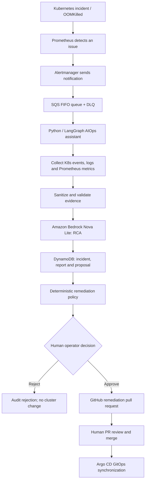
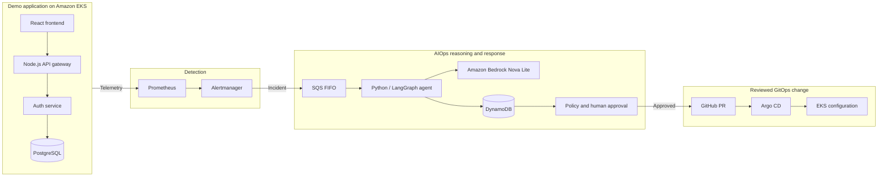
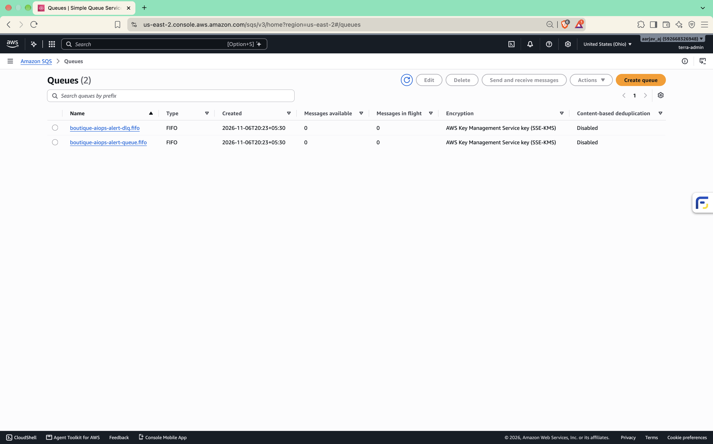
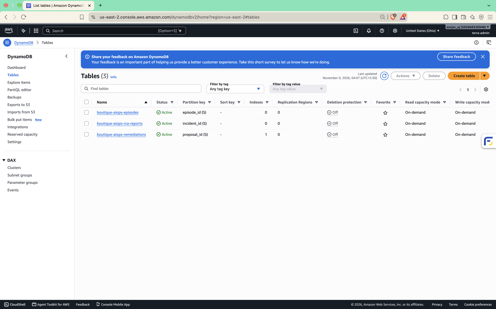
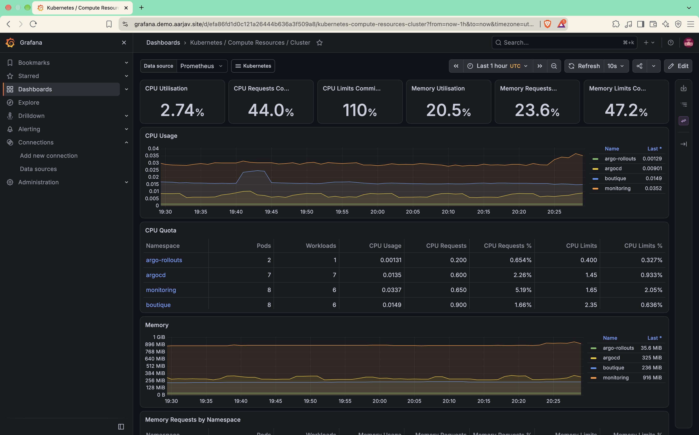
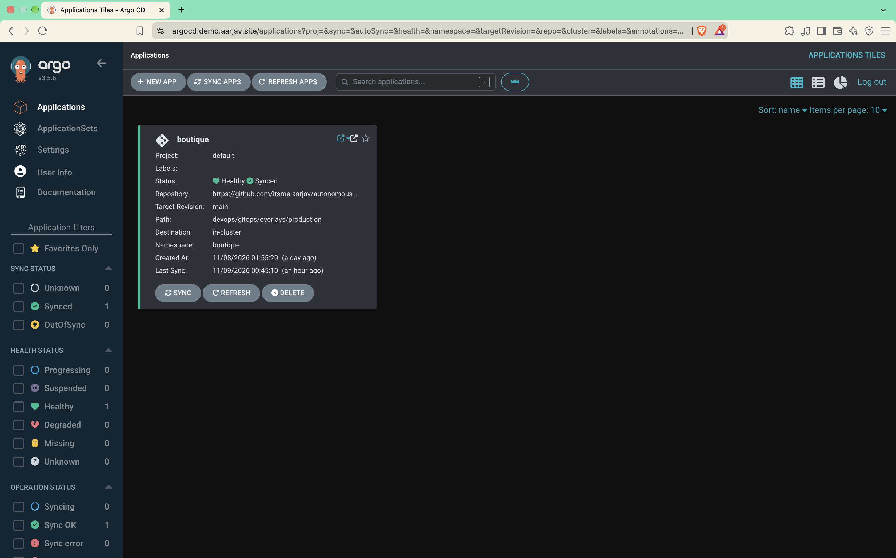

<div align="center">

# Autonomous DevSecOps & Cloud Operations Platform

### AIOps-Driven Incident Detection, Root Cause Analysis & Human-Approved GitOps Remediation

**A hands-on AWS AIOps project that investigates real Kubernetes failures using Amazon Bedrock Nova Lite, LangGraph and cloud observability.**

[](https://github.com/itsme-aarjav/autonomous-devsecops-platform/actions/workflows/platform.yml)


[AIOps Workflow](#aiops-workflow) · [Technology Stack](#technology-stack) · [Real Incident & Proof](#live-aiops-incident-oomkilled-to-approved-fix) · [Architecture](#system-architecture) · [Screenshots](#aiops-and-cloud-proof-gallery) · [Documentation](#repository-guide)

</div>

> **Project status:** Built and live-verified on Amazon EKS in `us-east-2`, including a genuine OOMKilled incident, Bedrock diagnosis, operator approval and a merged remediation PR. The project-owned AWS infrastructure was **decommissioned after testing** to avoid recurring costs. Historical demo and dashboard URLs are no longer available; code, CI history and recorded evidence remain in GitHub.

## Project overview

### What problem does this solve?

Kubernetes monitoring can detect a failing container, but engineers still need to collect logs, find the cause, decide on a safe fix and deploy it. This project brings those steps into one **AI-assisted incident response workflow**.

The **AIOps assistant** is the core of the project. It consumes alerts, gathers read-only Kubernetes and Prometheus evidence, removes sensitive data, and asks **Amazon Bedrock Nova Lite** to generate a root cause analysis (RCA). A policy engine checks the proposed change. An authenticated human reviews the diff before a GitHub pull request is created and merged through GitOps.

A small **React + Node.js + PostgreSQL boutique application** provides the real infrastructure and workloads to deploy, monitor and troubleshoot. Terraform, EKS, GitHub Actions and Argo CD support the AIOps system.

### What was built?

| Area | Implemented capability |
| --- | --- |
| **AIOps diagnosis** | Eight-node LangGraph workflow with Bedrock Converse API and Pydantic validation |
| **Incident intake** | Prometheus and Alertmanager alerts sent to an Amazon SQS FIFO queue |
| **Incident state** | DynamoDB episodes, deduplication, RCA reports and remediation proposals |
| **Evidence gathering** | Read-only Kubernetes API and predefined Prometheus queries; sensitive data sanitization |
| **Safe remediation** | Allowlisted YAML changes, IAM/operator authentication, approval CLI and GitHub PR review |
| **GitOps recovery** | Argo CD synced the merged Kubernetes manifest; a real canary memory fix was demonstrated |
| **Cloud foundation** | Terraform, Amazon EKS, Docker, ECR, IAM, VPC networking and AWS encryption |
| **Operations** | CI/CD, Trivy scans, Grafana dashboards and verified PostgreSQL backup/restore |

## Technology stack

### AIOps & AI reasoning — primary focus

       

| Technology | Role in AIOps |
| --- | --- |
| **Python + LangGraph** | Run the eight-step diagnosis and proposal workflow |
| **LangChain Core + Pydantic** | Support graph state, structured data models and validation |
| **Amazon Bedrock Nova Lite** | Produce an RCA from sanitized telemetry using the Converse API |
| **Boto3 (AWS SDK)** | Connect to Bedrock, SQS and DynamoDB using AWS credentials |

### Alerting, telemetry & incident storage

        

**Prometheus / PromQL** provided metrics, **Alertmanager** raised incidents, **SQS FIFO** buffered alerts with a dead-letter queue for failed messages, and **DynamoDB** tracked incident episodes and proposals. The agent gathered Kubernetes evidence using the **Kubernetes Python client** and monitoring evidence using **HTTP requests**.

### Human approval, security & GitOps

      

A deterministic policy engine restricted allowed fixes. **IAM identity checks and HMAC token verification** protected the operator approval step; the **GitHub API** opened the PR, and **Argo CD** reconciled the merged configuration.

### Cloud, CI/CD & automation

           

Terraform provisioned the AWS infrastructure; EKS ran the containers. GitHub Actions built, tested and scanned services. Argo Rollouts provided a **separate frontend canary strategy** (50% to 100% steps).

### Demo application

     

The storefront and backend were **supporting demo workloads** for testing deployment, monitoring and incident recovery—not the main focus of the AIOps project.


## AIOps workflow

### From alert to human-approved change



The AIOps system follows an **investigate → propose → review → deploy** model. It is not an AI bot with unrestricted Kubernetes write access.

### Inside the eight-node LangGraph agent

| Step | Agent node | What it does |
| --- | --- | --- |
| 1 | `validate_input` | Check the incoming incident payload |
| 2 | `normalize_incident` | Standardize the alert and detect duplicates |
| 3 | `collect_evidence` | Read relevant Kubernetes and Prometheus information |
| 4 | `sanitize_evidence` | Remove sensitive strings before sending logs to the model |
| 5 | `analyze_with_bedrock` | Generate structured RCA using **Nova Lite** |
| 6 | `validate_rca` | Validate the diagnosis against a structured schema |
| 7 | `persist_result` | Store the RCA and related incident data |
| 8 | `propose_remediation` | Evaluate a bounded change for human review |

Source: [LangGraph StateGraph implementation](aiops/agent/graph.py) and [agent README](aiops/README.md).

### Why this design?

- **AIOps rather than basic alerting:** The system collects context and proposes a fix instead of merely forwarding an alert.
- **Durable processing:** SQS FIFO and DynamoDB help handle duplicate alerts, incident state and worker recovery.
- **Read-only investigation:** Evidence adapters collect information without directly modifying workloads.
- **Model safety:** Logs are sanitized; structured output and deterministic policy checks limit what can be proposed.
- **Human control:** Approval is required to open a PR, and the PR must be merged before GitOps can apply a change.

[Agent implementation](aiops/) · [Detailed pipeline](proof/architecture/aiops-pipeline.md) · [Human approval proof](proof/terminal-outputs/30-aiops-human-approval-pr.txt)

## System architecture

This shows the **historical deployed environment** with AIOps at the center.



**Supporting cloud platform:** Terraform created VPC networking, EKS and supporting AWS resources. GitHub Actions validated and built four containers; during the live deployment it also published images to ECR. Argo CD read Kubernetes configuration from Git.

[Full cloud architecture](proof/architecture/system-architecture.md) · [Terraform layout](devops/terraform/README.md) · [CI/CD design](proof/ci-cd/ci-cd-architecture.md)

## Live AIOps incident: OOMKilled to approved fix

The key achievement was a **real OOMKilled (exit code 137)** failure on AWS EKS, followed by alert detection, **Bedrock Nova Lite RCA**, human approval and a merged remediation PR. This was a controlled **test canary workload**, separate from the storefront and its Argo Rollouts configuration.

| Stage | What happened | Real evidence |
| --- | --- | --- |
| **1. Detect** | Controlled memory pressure terminated the canary; Prometheus detected it and Alertmanager routed the incident through SQS FIFO. | [OOMKilled](proof/terminal-outputs/09-aiops-oomkilled.txt) · [Prometheus](proof/terminal-outputs/11-prometheus-oom-alert.txt) · [Alertmanager](proof/terminal-outputs/12-alertmanager-incident.txt) |
| **2. Diagnose** | LangGraph gathered sanitized evidence and invoked **Amazon Bedrock Nova Lite**; RCA and proposals were stored in DynamoDB. | [Processing](proof/terminal-outputs/13-aiops-processing.txt) · [DynamoDB proposal](proof/terminal-outputs/14-aiops-dynamodb-proposal.txt) |
| **3. Apply guardrails** | An earlier proposal was rejected. A later policy-approved proposal was inspected by the operator. | [Rejection](proof/terminal-outputs/17-aiops-human-rejection.txt) · [Review](proof/terminal-outputs/29-aiops-approval-review.txt) |
| **4. Approve and create PR** | Authenticated operator approval opened **GitHub PR #2**, proposing a minimal YAML memory change. | [Operator approval](proof/terminal-outputs/30-aiops-human-approval-pr.txt) · [PR #2](https://github.com/itsme-aarjav/autonomous-devsecops-platform/pull/2) |
| **5. Verify** | The PR merged, GitOps synchronized and the final canary manifest contains the higher memory configuration. | [PR merge](proof/terminal-outputs/32-aiops-gitops-pr-merge.txt) · [Final manifest](devops/gitops/overlays/production/canary.yml) |

### Verified canary memory change

| Setting | Before | After approved fix |
| --- | ---: | ---: |
| Memory request | `64Mi` | **`256Mi`** |
| Memory limit | `128Mi` | **`512Mi`** |

**The important safety decision:** The AI did **not** get permission to modify EKS resources directly. It generated a diagnosis and policy-checked proposal; an operator approved the diff, and GitHub/Argo CD handled the reviewed GitOps update.

The frontend's Argo Rollouts manifest is a **different canary feature** with **50% → 100%** steps. See [frontend rollout configuration](devops/gitops/overlays/production/frontend.yml).

## AIOps commands and outputs

These are the main **operator commands used to review and act on AIOps proposals**. Run them from the repository root with an authorized AWS identity, the correct region, and required approval/GitHub credentials. **The AWS demo has been deleted, so the live commands below are historical instructions, not working commands for the current environment.** The outputs are shortened from saved proof files; where a standalone command output was not recorded, the example is labeled.

### 1. Check the proposal in DynamoDB

The agent stored the diagnosis in `boutique-aiops-rca-reports` and the suggested fix in `boutique-aiops-remediations`.

```bash
export AWS_DEFAULT_REGION=us-east-2
aws sts get-caller-identity

aws dynamodb scan \
  --table-name boutique-aiops-remediations \
  --projection-expression "proposal_id,incident_id,proposal_status,workload"
```

**Recorded DynamoDB proposal** ([proof 14](proof/terminal-outputs/14-aiops-dynamodb-proposal.txt), reformatted here; not the exact `aws dynamodb scan` stdout):

```text
ProposalID: 597a71c7dbb432d2
Status:     PENDING_HUMAN_APPROVAL
Workload:   canary
Category:   Pod OOMKilled
```

To read the complete diagnosis, open the **RCA reports table** in AWS DynamoDB Console or look up its item by `incident_id`. The saved [RCA processing log](proof/terminal-outputs/13-aiops-processing.txt) also confirms that Bedrock succeeded and the report was stored.

### 2. List proposals awaiting approval

```bash
python3 aiops/operator_cli.py list --status pending
```

**Example CLI output** based on the real saved proposal (no separate `list` terminal capture was retained):

```text
597a71c7dbb432d2  PENDING_HUMAN_APPROVAL  canary  Pod OOMKilled  confidence=95%
```

Copy the proposal ID from the list. **`PENDING_HUMAN_APPROVAL` means the AI has proposed a fix, but no operator has approved it yet.**

### 3. Inspect the diagnosis and exact YAML change

```bash
python3 aiops/operator_cli.py show 0abe485a55e34e73
```

**Recorded human review output** ([proof 29](proof/terminal-outputs/29-aiops-approval-review.txt), shortened):

```diff
Proposal ID : 0abe485a55e34e73
Status      : PENDING_HUMAN_APPROVAL
Category    : Pod OOMKilled
Action Type : SET_MEMORY_RESOURCES
Confidence  : 95%
Policy      : APPROVED
- memory: 64Mi
+ memory: 256Mi
- memory: 128Mi
+ memory: 512Mi
```

**`Policy: APPROVED` is not human approval.** It means the suggested change passed the project's safety rules.

### 4. Reject a proposal when its diff is unsafe

```bash
python3 aiops/operator_cli.py reject 597a71c7dbb432d2 \
  --reason "Excessive YAML reformatting; change only memory values"
```

The CLI requires operator authentication and manually typing `REJECT`. **Recorded output** ([proof 17](proof/terminal-outputs/17-aiops-human-rejection.txt), shortened):

```text
[OK] Proposal '597a71c7dbb432d2' successfully rejected
Reason: Human review rejected excessive YAML reformatting.
```

A rejected proposal does **not** open a remediation PR. [DynamoDB rejection audit](proof/terminal-outputs/18-aiops-rejection-audit.txt).

### 5. Approve a safe proposal and create a PR

```bash
python3 aiops/operator_cli.py approve 0abe485a55e34e73
```

The CLI shows the diff, checks the operator's authorization and asks the human to type `APPROVE`. **Recorded output** ([proof 30](proof/terminal-outputs/30-aiops-human-approval-pr.txt), shortened):

```text
[SUCCESS] Remediation Pull Request created successfully for human review!
Mode      : AUTHENTICATED
PR Number : #2
PR URL    : https://github.com/itsme-aarjav/autonomous-devsecops-platform/pull/2
```

Approval **creates a pull request; it does not directly patch the cluster**.

### 6. Check status, review the PR, and verify delivery

```bash
python3 aiops/operator_cli.py status 0abe485a55e34e73

gh pr view 2
gh pr diff 2
```

**Expected `status` format**, derived from the CLI code and recorded [DynamoDB approval audit](proof/terminal-outputs/31-aiops-approval-audit.txt); a standalone `status` command capture was not retained:

```text
Proposal '0abe485a55e34e73': status=PR_CREATED
  Pull Request  : https://github.com/itsme-aarjav/autonomous-devsecops-platform/pull/2
```

An operator then **reviews and merges the PR in GitHub**. In the real demo, [PR #2](https://github.com/itsme-aarjav/autonomous-devsecops-platform/pull/2) was merged, and Argo CD synchronized the GitOps change. The final canary manifest records `256Mi` request and `512Mi` limit. See [merge log](proof/terminal-outputs/32-aiops-gitops-pr-merge.txt) and [final manifest](devops/gitops/overlays/production/canary.yml).

**No AWS available now?** You can still explore the CLI's **offline sample proposals** with `python3 aiops/operator_cli.py list --simulate` and `python3 aiops/operator_cli.py show sim-prop-001 --simulate`. These use in-memory fixtures, **not real Bedrock, DynamoDB, or GitHub**.

## CI/CD and deployment

The delivery pipeline supported the AIOps assistant and demo workloads. The historical release process was:

```text
Code push / pull request
       |
       v
Terraform, Ansible, shell and Kustomize checks
       |
       v
AIOps tests + Trivy filesystem scan
       |
       v
Build and scan four Docker images
       |
       v
ECR publish -> GitOps image update -> Argo CD sync -> EKS verification
                     (historical live deployment only)
```

**Four container images** (including the AIOps agent): `boutique-frontend`, `boutique-gateway`, `boutique-auth`, and `boutique-aiops-assistant`.

The pipeline uses Trivy for security scans and GitHub OIDC for short-lived AWS credentials during its historical deployment path. **After teardown**, validation and image-build checks still run, but **ECR publishing and EKS deployment are disabled** so routine pushes do not recreate cloud resources.

[Current GitHub Actions](https://github.com/itsme-aarjav/autonomous-devsecops-platform/actions) · [Successful historical deployment](https://github.com/itsme-aarjav/autonomous-devsecops-platform/actions/runs/42529170045) · [CI/CD explanation](proof/ci-cd/ci-cd-architecture.md)

## AIOps safety, backups & recovery

| Area | Implementation |
| --- | --- |
| **AWS authentication** | GitHub OIDC and IAM roles instead of storing permanent AWS access keys in Actions |
| **Secrets** | AWS Secrets Manager and Kubernetes Secrets for application credentials |
| **Encryption** | AWS KMS used with project data services and S3 PostgreSQL backups |
| **Container checks** | Trivy scanning; non-root containers and restrictive settings where configured |
| **AIOps remediation safety** | Read-only evidence, policy allowlist, Pydantic validation, operator identity checks, HMAC token verification, and PR review |
| **Database recovery** | A Kubernetes CronJob used `pg_dump` and uploaded compressed SQL files to S3 at **2:00 AM IST** |

**Backup test result:** An S3 SQL archive was restored into a temporary PostgreSQL pod. The test checked **five tables**, their row counts, and **eight product records**. The pod was removed after testing. This was an isolated **test database**, not a claim of network air-gapping. An EBS snapshot recovery test was documented separately.

[SQL restore terminal proof](proof/terminal-outputs/35-isolated-backup-restore-verification.txt) · [Backup design](proof/backup-recovery/s3-daily-backup.md) · [EBS restore record](proof/backup-recovery/restore-verification.md) · [Security details](proof/security/security-architecture.md)

## AIOps and cloud proof gallery

All images below were captured **during live AWS verification**, before infrastructure teardown. The first row shows the services behind the AIOps incident pipeline.

| **AIOps: SQS FIFO alert queues** | **AIOps: DynamoDB incident tables** |
| :---: | :---: |
| [](proof/architecture/26-aws-sqs-fifo-queues.png) | [](proof/architecture/25-aws-dynamodb-tables.png) |
| **Prometheus/Grafana monitoring** | **Argo CD GitOps status** |
| [](proof/monitoring/04-grafana-cluster-compute-resources.png) | [](proof/ci-cd/02-argocd-application-overview.png) |
| **Amazon EKS cluster** | **Supporting demo storefront** |
| [](proof/kubernetes/20-aws-eks-cluster-info.png) | [](proof/architecture/01-storefront-ui-demo.png) |

### The most useful AIOps proof links

| Evidence | Why it matters |
| --- | --- |
| [Real OOMKilled pod log](proof/terminal-outputs/09-aiops-oomkilled.txt) | Actual Kubernetes OOMKilled reason and exit code 137 |
| [SQS-to-agent processing](proof/terminal-outputs/13-aiops-processing.txt) | AIOps processing after alert delivery |
| [Stored RCA/proposal](proof/terminal-outputs/14-aiops-dynamodb-proposal.txt) | AI diagnosis and persisted incident details |
| [Operator approval](proof/terminal-outputs/30-aiops-human-approval-pr.txt) | Authenticated review and GitHub PR creation |
| [Merged GitOps remediation PR #2](https://github.com/itsme-aarjav/autonomous-devsecops-platform/pull/2) | Real reviewed manifest change |
| [Screenshot catalog](proof/screenshots/README.md) | All **28** categorized screenshots |
| [Terminal log catalog](proof/terminal-outputs/README.md) | **36** proof stages across **38** text files |

## Repository guide

```text
autonomous-devsecops-platform/
├── aiops/                     Core AIOps agent, LangGraph, Bedrock, SQS, policy, operator CLI
├── application/               Supporting React + Node.js boutique demo workloads
├── devops/
│   ├── terraform/             AWS infrastructure and state configuration
│   ├── gitops/                Kubernetes manifests and Argo CD
│   ├── ansible/               Supporting operational automation
│   └── observability/         Monitoring configuration
├── .github/workflows/         CI and historical cloud-deployment workflow
└── proof/                     Screenshots, logs, recovery and teardown records
```

### Technical documentation

**Start with the AIOps source and evidence**, then explore its supporting cloud services.

| Read this | To understand |
| --- | --- |
| [AIOps README](aiops/README.md) | LangGraph steps, Bedrock, policies and human approval |
| [Terraform README](devops/terraform/README.md) | Cloud infrastructure roots, S3 state and teardown |
| [System architecture](proof/architecture/system-architecture.md) | Networking and component connections |
| [CI/CD architecture](proof/ci-cd/ci-cd-architecture.md) | Validation, build, scanning and GitOps |
| [Monitoring](proof/monitoring/observability-stack.md) | Prometheus, Alertmanager and Grafana |
| [Security](proof/security/security-architecture.md) | IAM, OIDC, encryption and approvals |
| [Proof index](proof/README.md) | All visual and terminal verification |

## Local checks

These commands validate parts of the repository **without creating AWS infrastructure**. Install their normal dependencies first.

```bash
# From repository root: AIOps unit and security tests
python3 -m unittest discover -s aiops/tests -p "test_*.py" -v

# Terraform formatting (no apply)
terraform fmt -recursive -check devops/terraform

# Kubernetes manifest rendering (no deploy)
kubectl kustomize devops/gitops/overlays/production

# Frontend production build
cd application/frontend
npm ci
npm run build
```

The local test suite and manifest checks are **not substitutes** for the saved live AWS evidence.

## Current project status

| Item | Status |
| --- | --- |
| **Real AIOps diagnosis and incident remediation** | **Completed on live AWS** |
| AWS deployment and live incident verification | **Completed historically** |
| Human-approved GitOps remediation | **Verified with PR #2** |
| PostgreSQL backup and test restore | **Verified** |
| Screenshots and terminal proofs | **Preserved in GitHub** |
| GitHub CI validation and security checks | **Remain enabled** |
| ECR publishing and cloud deployment | **Disabled after teardown** |
| Project-owned AWS infrastructure | **Intentionally decommissioned** |

The remaining project-owned S3 Terraform state bucket is estimated to cost **less than $0.01 per month**, pending confirmation from AWS billing. Older, unrelated AWS resources are excluded. Historical usage charges may still appear on the account invoice.

**Scope:** This is a personal, hands-on portfolio project with controlled incident testing. It does not claim real customer traffic, commercial production availability, or a continuously running public demo.

---

<div align="center">

**An AIOps-first DevSecOps, Cloud and SRE engineering portfolio project.**

[View GitHub Actions](https://github.com/itsme-aarjav/autonomous-devsecops-platform/actions) · [Explore the proof package](proof/README.md) · [See the remediation pull request](https://github.com/itsme-aarjav/autonomous-devsecops-platform/pull/2)

</div>