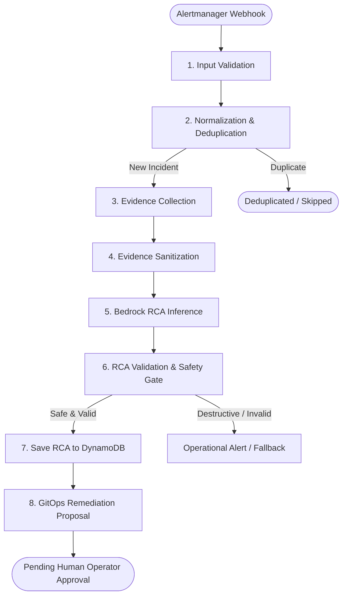

# Autonomous AIOps SRE Assistant

This directory contains the in-cluster AIOps assistant built with **Python 3.11**, **LangGraph**, and **Amazon Bedrock**.

---

## 1. What It Is & Why We Built It

When production incidents occur (such as a Kubernetes pod running out of memory), site reliability engineers usually spend 15–30 minutes manually checking logs, reading metrics, and debugging root causes before preparing a fix.

The **AIOps Assistant** automates this diagnostic investigation. It listens for alerts, collects diagnostic telemetry, sanitizes sensitive credentials, generates structured Root Cause Analysis (RCA) using an AI model, and proposes surgical GitOps manifest fixes for human review.

---

## 2. The 8-Node LangGraph Diagnostic Pipeline

The assistant implements an 8-node directed acyclic graph (DAG) using `langgraph.graph.StateGraph`:



### Explanation of Each Step:

1. **`validate_input`**: Validates the incoming alert payload against Pydantic models (`IncidentInput`), checking severity and category.
2. **`normalize_incident`**: Generates a deterministic SHA-256 hash across namespace, workload, and category. If an identical alert is already being processed, duplicates are safely ignored.
3. **`collect_evidence`**: Queries the cluster using read-only Kubernetes and Prometheus adapters. It retrieves container exit codes (e.g., exit code 137 for OOMKilled), termination reasons, recent events, and memory usage rates.
4. **`sanitize_evidence`**: Strips bearer tokens, database passwords, private keys, and internal IPs from logs and metrics before sending data to the AI model.
5. **`analyze_with_bedrock`**: Sends sanitized telemetry to **Amazon Bedrock Nova Lite** (`amazon.nova-lite-v1:0`). Nova Lite was chosen because it delivers sub-4 second structured JSON responses at very low token cost.
6. **`validate_rca`**: Validates the AI response against a strict schema. It strictly checks that `is_destructive: false` and rejects destructive commands such as `rm -rf`, `DROP TABLE`, or `kubectl delete`.
7. **`persist_result`**: Stores the completed RCA report and episode record in Amazon DynamoDB (`boutique-aiops-rca-reports` and `boutique-aiops-episodes`).
8. **`propose_remediation`**: Evaluates the RCA against a deterministic policy engine and renders a unified GitOps manifest diff (e.g., increasing container memory limits).

---

## 3. Resilient Ingestion: SQS FIFO & DynamoDB

The assistant operates in a decoupled, event-driven pattern:

- **Amazon SQS FIFO Queue (`boutique-aiops-alert-queue.fifo`)**:
  - Ingests firing webhooks from Alertmanager and acknowledges them with `HTTP 202 Accepted`.
  - Preserves alert ordering and prevents duplicate message handling.
  - Poisoned or unprocessable alerts move to a Dead-Letter Queue (DLQ) after 3 failed attempts.
- **Amazon DynamoDB Episode Store**:
  - Tracks investigation state and prevents multiple assistant replicas from analyzing the same incident simultaneously.
  - Records automatically expire after 24 hours using DynamoDB Time to Live (TTL).

---

## 4. Human-in-the-Loop GitOps Self-Healing

The assistant never makes direct, unreviewed writes to production clusters or Git branches.

```
Prometheus Alert (Pod OOMKilled)
       │
       ▼
Amazon Bedrock RCA & Deterministic Policy Check
       │
       ▼
Cloud Operator CLI Review (`aiops/operator_cli.py list / show`)
       │
       ▼
Constant-Time HMAC Token Approval (`aiops/operator_cli.py approve`)
       │
       ▼
Reviewed GitHub Pull Request Opened (`fix/aiops-proposal-<id>`)
       │
       ▼
Human Merge to `main` & Argo CD Automatic Reconciliation
```

### Key Safety Invariants:

1. **Deterministic Policy Bounds**: The AI model cannot generate arbitrary changes. Allowed changes are strictly bounded:
   - Target namespace: `boutique` only.
   - Target workloads: `frontend`, `gateway`, `auth`, `canary`.
   - Workload memory limits: bounded between `128Mi` and `1024Mi`.
   - Pod replicas: integer between `1` and `5`.
2. **Constant-Time Token Authentication**: Operators authenticate via `TrustedTokenApprovalAuthenticator` using `hmac.compare_digest` against pre-shared credentials. This prevents timing attacks.
3. **Reviewed Pull Request Policy**: Approved fixes generate a dedicated feature branch and open a reviewed GitHub Pull Request. Direct commits to `main` are blocked by policy. Once a human merges the PR, Argo CD synchronizes the change.

---

## 5. Security & EKS Pod Identity

In the cluster, the assistant pod authenticates without static AWS credentials:
- **ServiceAccount**: `aiops-assistant` in namespace `boutique`.
- **IAM Role**: `boutique-dev-eks-aiops-agent-role` via EKS Pod Identity.
- **Permissions**: Restricted strictly to `bedrock:InvokeModel`, reading SQS alerts, and reading/writing DynamoDB proposal tables. Cluster RBAC is strictly read-only (`get`, `list`).

---

## 6. Testing & Quality Verification

The AIOps engine includes **27 unit and security regression tests**:

```bash
# Run the complete AIOps test suite locally
python3 -m unittest discover -s aiops/tests -p "test_*.py" -v
```

### What These Tests Cover:
- **`test_approval_safety.py` (22 tests)**: Verifies constant-time HMAC token authentication, PR creation guards, rejection handling, path traversal protection, and thread safety.
- **`test_canary_remediation.py` (5 tests)**: Verifies end-to-end memory remediation generation for canary workloads, ensuring output limits match policy bounds (`256Mi` requests, `512Mi` limits).

---

## 7. Related Proof Artifacts

- [AIOps Sequence Diagram Architecture](../proof/architecture/aiops-pipeline.md): Detailed event flow and deduplication.
- [DynamoDB Tables Screenshot](../proof/architecture/25-aws-dynamodb-tables.png): Visual proof of active DynamoDB tables.
- [SQS FIFO Queues Screenshot](../proof/architecture/26-aws-sqs-fifo-queues.png): Visual proof of encrypted FIFO incident queues.
- [Live AIOps Incident Terminal Logs](../proof/terminal-outputs/README.md): Logs `08` through `34` demonstrating detection, RCA, operator review, approval, PR creation, and GitOps recovery.
