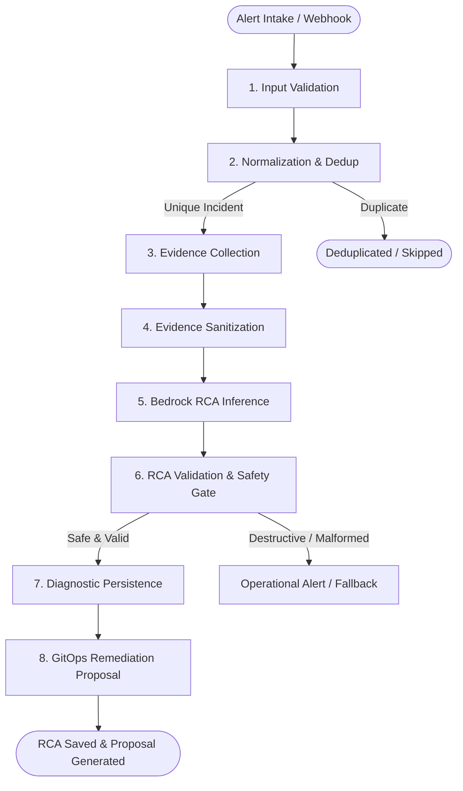

# Autonomous AIOps Assistant

An in-cluster, autonomous site reliability engineering assistant built on **LangGraph**, the **Amazon Bedrock Converse API**, and declarative **GitOps Remediation Engine**. The engine ingests Prometheus Alertmanager webhooks and Kubernetes incident notifications via durable queues, executes read-only diagnostic telemetry collection, sanitizes logs and metrics, produces structured Root Cause Analysis (RCA) reports, and deterministically generates policy-bounded **declarative GitOps remediation proposals** requiring human operator approval.

---

## Architecture: 8-Node LangGraph StateGraph

The diagnostic and remediation engine is implemented as a deterministic, directed acyclic graph (DAG) using `langgraph.graph.StateGraph`:



### Pipeline Nodes
1. **Input Validation (`validate_input`)**: Strictly parses incident payloads against Pydantic models (`IncidentInput`), verifying required fields, severity levels, and category classifications.
2. **Normalization & Deduplication (`normalize_incident`)**: Generates deterministic SHA256 deduplication hashes across incident attributes (`namespace`, `affected_workload`, `category`) to prevent redundant LLM invocations during alert storms.
3. **Read-Only Evidence Collection (`collect_evidence`)**: Queries cluster telemetry using read-only Kubernetes and Prometheus adapters (fetching pod status, container exit codes, termination reasons, event streams, and Prometheus metric rates).
4. **Evidence Sanitization (`sanitize_evidence`)**: Redacts bearer tokens, database connection URIs, AWS access keys, and internal IPs; enforces line count and byte length limits to protect prompt token budgets and prevent data leakage.
5. **Bedrock RCA Inference (`analyze_with_bedrock`)**: Synthesizes telemetry using Amazon Bedrock Runtime Converse API (`us.anthropic.claude-haiku-4-5-20251001-v1:0` or `claude-sonnet`). Employs prompt injection defenses treating all logs and metrics strictly as untrusted data.
6. **RCA Validation & Safety Gate (`validate_rca`)**: Validates the model output against `RootCauseAnalysis` schema. Enforces that `is_destructive: false` and scans recommended actions against forbidden destructive command patterns (`kubectl delete`, `rm -rf`, `helm uninstall`, `drop database`, etc.).
7. **Diagnostic Persistence (`persist_result`)**: Records the completed investigation report in Amazon DynamoDB (or local file adapter) and associates the deduplication key with the generated incident record.
8. **GitOps Remediation Proposal (`propose_remediation`)** *(Stage 6.5)*: Evaluates validated RCA outcomes against a deterministic policy engine, renders allowlisted Kubernetes manifest patches, and records a structured remediation proposal awaiting operator approval.

---

## Durable Queue & Episode Store Architecture (Stage 6.4.3)

In production environments, the AIOps assistant operates in a resilient, decoupled event-driven mode:

- **Amazon SQS FIFO Alert Queue (`SQSAlertQueue`)**:
  - Enforces deterministic message group deduplication.
  - Ingests firing alerts from Alertmanager webhooks and responds with `HTTP 202 Accepted` within milliseconds.
  - Manages message visibility and supports Dead-Letter Queue (DLQ) redrive after 3 failed investigation attempts.
- **Amazon DynamoDB Episode Lifecycle Store (`DynamoDBEpisodeStore`)**:
  - Implements atomic worker lease acquisition (`claim_episode`), preventing concurrent duplicate investigations across replicas.
  - Workers run background heartbeat threads extending SQS visibility and renewing DynamoDB leases.
  - Out-of-order alert handling: resolved notifications cleanly cancel pending or in-flight investigations without invoking Bedrock.
  - Automatic 24-hour TTL expiration on episode state.
- **Dual-Write Prevention**:
  - Webhook handlers enqueue firing alerts to SQS without creating premature DynamoDB records.
  - Queue messages are deleted only after investigation completion and RCA report persistence are verified.

---

## Declarative GitOps Remediation Engine (Stage 6.5)

Stage 6.5 introduces an autonomous, supervised GitOps remediation generator. It converts validated RCA findings into concrete, declarative Kubernetes manifest updates aligned to the platform's strict **Single-Main Branch Policy**.

### 1. Supervised Human-in-the-Loop Philosophy
The remediation system is strictly non-destructive:
- **No live cluster mutations**: Kubernetes RBAC remains strictly read-only (`get`, `list`). No `create`, `update`, `patch`, or `delete` verbs exist on workloads.
- **Mandatory Operator Approval**: Modifications require explicit authorization via `TrustedTokenApprovalAuthenticator` (`hmac.compare_digest`). Unsigned or invalid requests fail closed.
- **Declarative GitOps Delivery**: Cluster changes occur only after an authorized operator approves the proposal, updating manifests on `main` for Argo CD reconciliation.

### 2. Deterministic Remediation Policy Engine
The LLM does **not** generate arbitrary shell commands or unvetted YAML patches. Deterministic code enforces strict safety constraints:
- **Confidence Gate**: Requires RCA confidence score $\ge 0.70$.
- **Destructive Action Block**: Immediately rejects any proposal where `is_destructive == True`.
- **Workload & Namespace Allowlist**:
  - Permitted Namespace: `boutique` only.
  - Permitted Services: `auth`, `frontend`, `gateway`.
- **Manifest File Allowlist**:
  | Workload | Permitted Target Manifest | Kind |
  | :--- | :--- | :--- |
  | `auth` | `devops/gitops/k8s/backend/auth.yml` | Deployment |
  | `gateway` | `devops/gitops/k8s/backend/gateway.yml` | Deployment |
  | `frontend` | `devops/gitops/k8s/frontend/rollout.yaml` | Rollout |
  *(Rejects path traversal `../`, absolute paths, database manifests, RBAC, service accounts, or infrastructure files).*
- **Action-to-Category Mapping**:
  - `Pod OOMKilled` $\rightarrow$ `SET_MEMORY_RESOURCES` only.
  - `High CPU utilization` / `Application HTTP 5xx spike` $\rightarrow$ `SCALE_REPLICAS` or `SET_CPU_RESOURCES`.
  - `Deployment replicas unavailable` $\rightarrow$ `SCALE_REPLICAS`.
- **Resource Sizing Bounds**:
  - `replicas`: strictly integer between `1` and `5`.
  - `memory_limit`: between `128Mi` and `1024Mi` (1Gi), and `limit >= request`.
  - `cpu_limit`: between `100m` and `2000m` (2 cores), and `limit >= request`.
- **Secret & Credential Filtering**:
  - Scans proposals and generated diffs against regex patterns for tokens, passwords, database URIs, and private keys. Any match aborts the proposal.

### 3. Repository Interfaces & Providers
- **Human-Reviewed Pull Request Policy**:
  - In production mode, direct autonomous commits to `main` are strictly forbidden (`PermissionError`). Every approved remediation generates a dedicated feature branch (`fix/aiops-proposal-<id>`) and opens a reviewed GitHub Pull Request embedding the RCA and unified diff for human inspection.
- **Provider Interfaces**:
  - `BaseGitHubProvider`: Abstract interface for repository inspection, pull request generation, and declarative manifest updates.
  - `GitHubApiProvider`: Production standard library HTTP implementation interacting directly with the GitHub API. Application code uses real provider logic exclusively; test-local doubles are isolated to test files.

### 4. Idempotency, Traceability & Human Approval Security
- **Constant-Time Human Approval Authentication**: `apply_approved_remediation()` enforces authenticated operator verification via `TrustedTokenApprovalAuthenticator` using `hmac.compare_digest` against pre-shared tokens. Caller-supplied operator strings alone are never accepted as proof of approval; invalid or missing tokens fail closed. This mechanism uses pre-shared token comparison rather than dynamic HMAC cryptographic signatures over the payload.
- **Process-Local Locking & Concurrency Boundary**: Thread safety within a running engine instance is enforced via `threading.Lock()` (`self._apply_lock`), which serializes concurrent approval requests for the same proposal and prevents duplicate pull requests within the process. As `threading.Lock()` is process-local and not a distributed mutex, cross-pod concurrency is governed at the Kubernetes orchestration level by running the AIOps deployment as a single-replica active singleton (`replicas: 1`, `strategy: Recreate`).
- **Proposal Idempotency & Durable Failure Recovery**:
  - Once applied, proposals transition to `PR_CREATED` and store the created Pull Request URL. Repeated approval calls return immediately without duplicate git mutations.
  - Every remediation embeds `Proposal-ID: <proposal_id>` in the PR body and branch reference. Before creating a new PR, the engine queries existing branches and PRs. If an existing PR for the proposal is detected, the engine reconciles the proposal state to `PR_CREATED` without creating a duplicate PR.
  - **Atomic Proposal Lifecycle in DynamoDB**: `DynamoDBRemediationStore` executes atomic conditional updates (`attribute_exists` / `status = :pending`) to guarantee CAS transitions between `PENDING_HUMAN_APPROVAL`, `APPLICATION_IN_PROGRESS`, and `PR_CREATED`.
  - **Atomic File Store POSIX Semantics**: `LocalFileRemediationStore` writes to uniquely named temporary files (`.{filename}.tmp.{uuid4}`) within the same directory before performing an atomic POSIX `os.replace()`. This prevents concurrent write collisions (even across identical PIDs) and ensures readers never encounter partial JSON. Note that `os.replace()` provides single-host filesystem reader atomicity, not multi-node distributed locking or atomic compare-and-swap.
- **Testing Fidelity**: Offline unit tests and fault injection utilize test-local doubles and mocks rather than mutating remote GitHub repositories.
- **Deterministic Proposal Naming**: `remediation/aiops-{workload}-{episode_id[:12]}`.
- **Duplicate Prevention**: Before creating remediation actions, queries existing proposals and GitOps state. If an existing proposal is active, records `status = PROPOSAL_EXISTS` without duplicate action.
- **Provenance & Review Audit**: Every proposal record includes:
  - Incident ID, Episode ID, Category, Severity, and Detection Timestamp.
  - Root Cause Summary and supporting evidence.
  - Policy Decision details and verified boundaries.
  - Unified diff of proposed declarative modifications.
  - Mandatory Human Review Checklist and authenticated approval signature.

---

## Authentication & EKS Pod Identity

When deployed on Amazon EKS Auto Mode, the assistant uses EKS Pod Identity:
- **Namespace**: `boutique`
- **ServiceAccount**: `aiops-assistant`
- **IAM Role**: `boutique-dev-eks-aiops-agent-role`
- **Permissions**:
  - `bedrock:InvokeModel` restricted to US Anthropic inference profiles (`us.anthropic.*`).
  - `s3:PutObject` / `s3:GetObject` on the dedicated diagnostic bucket (`nodediagnostics/*`).
  - `kms:Decrypt` and `kms:GenerateDataKey` on the platform Customer Managed Key (CMK).
  - `sqs:ReceiveMessage`, `sqs:DeleteMessage`, `sqs:ChangeMessageVisibility` on FIFO alert queue.
  - `dynamodb:GetItem`, `dynamodb:PutItem`, `dynamodb:UpdateItem` on episode and RCA tables.

---

## Testing & Quality Gates

The AIOps test suite contains **178 comprehensive tests** (177 passed, 1 skipped) covering schemas, adapters, sanitization, durable SQS/DynamoDB queues, and the Stage 6.5 remediation generator:

```bash
# Run complete AIOps test suite (offline Bedrock policy, zero cloud dependencies)
AIOPS_BEDROCK_ENABLED="false" PYTHONPATH=aiops python3 -m unittest discover -s aiops/tests -v
```

### Test Coverage Highlights:
- **`test_remediation_pr_generator.py` (40 tests)**:
  - Valid OOMKilled and High CPU remediation end-to-end proposal generation.
  - Unknown action, unsupported workload, and non-allowlisted namespace policy rejections.
  - Concurrent approval serialization via process-local lock and repeated approval idempotency.
  - Durable recovery: detecting already-applied proposals in Git history and reconciling store state without duplicate commits.
  - Two separate engine instances sharing a store and repo without creating duplicate commits.
  - GitHub reference conflict handling (409) and fail-closed persistence failure logging.
  - Path traversal attempts (`../../`) and manifest mismatch protections.
  - Resource boundary clamping and schema validation (`request <= limit`, `replicas <= 5`).
  - Secret leakage prevention across proposals and rendered diffs.
  - Frontend manifest synchronization (`rollout.yaml`).
  - Operator token verification via `TrustedTokenApprovalAuthenticator` (`hmac.compare_digest`) and fail-closed security.
  - Idempotent duplicate incident handling and existing proposal detection.
  - GitHub rate limit (429), auth error (401), and stale SHA conflict resilience.
  - LangGraph Node 8 integration and runtime worker queue integration.
  - Paginated commit history traversal across >20 intervening commits without false negatives.
  - Fail-closed error propagation for GitHub API rate limits, auth errors, and provider failures during discovery.
  - Unique per-write temp file isolation (`uuid4`) and collision-free concurrent disk writes in `LocalFileRemediationStore`.
  - Genuine simultaneous two-engine barrier test verifying atomic Git ref CAS update, conflict rejection, and retry reconciliation.
- **`test_durable_queue.py` (47 tests)**: SQS FIFO, DLQ redrive, DynamoDB leases, and out-of-order resolved alerts.
- **`test_webhook_receiver.py` (29 tests)**: Alertmanager v0.27.0 webhook parsing, constant-time bearer auth, bounded body limits.
- **`test_aiops_agent.py` & others (62 tests)**: Diagnostic pipeline, runtime event loop, sanitization, composite telemetry adapters, and node diagnostics.
