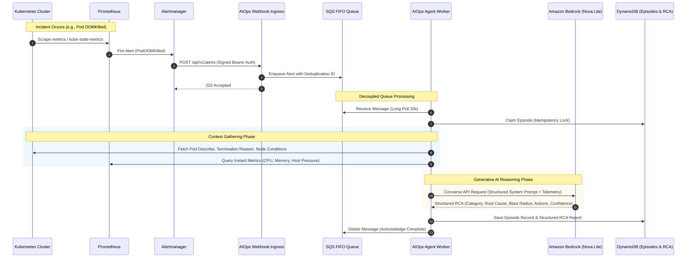

# Autonomous AIOps Reasoning Engine Architecture

The AIOps Assistant is an autonomous, event-driven site reliability engineering (SRE) agent designed to investigate, diagnose, and synthesize actionable root cause analysis (RCA) for infrastructure incidents.

---

## 1. Event-Driven Incident Lifecycle

When an incident occurs in the Kubernetes cluster (such as a container running out of memory), Prometheus detects the anomaly and Alertmanager routes the alert to the AIOps subsystem.



---

## 2. The 8-Node LangGraph Investigation Workflow

The core reasoning logic is organized as a directed acyclic graph (DAG) using LangGraph:

```
validate_input → normalize_incident → collect_evidence → sanitize_evidence → analyze_with_llm → validate_rca → propose_remediation → persist_result
```

1. **`validate_input`**: Validates the incoming payload structure against Pydantic schemas.
2. **`normalize_incident`**: Extracts standard fields (pod name, namespace, alert name, severity, firing timestamp).
3. **`collect_evidence`**: Executes read-only queries to gather Kubernetes pod events, container exit codes, termination reasons, and Prometheus metrics.
4. **`sanitize_evidence`**: Redacts sensitive data (JWTs, database passwords, API keys, internal tokens) using regular expressions before sending prompts to external APIs.
5. **`analyze_with_llm`**: Invokes Amazon Bedrock using the Converse API with Amazon Nova Lite (`amazon.nova-lite-v1:0`). Prompts request structured JSON containing root cause, confidence score, blast radius, and recommended actions.
6. **`validate_rca`**: Ensures the LLM response adheres to the strict Pydantic `RCAReport` schema with reasonable confidence scores.
7. **`propose_remediation`**: Runs the diagnosis through a deterministic policy engine. If the issue is a known memory exhaustion event and within allowed thresholds, it generates a surgical YAML patch.
8. **`persist_result`**: Stores the complete episode, RCA report, and remediation proposal in Amazon DynamoDB.

---

## 3. Key Resiliency & Reliability Mechanisms

### A. Strict Ingress Decoupling with Amazon SQS FIFO
- Instead of performing LLM inference synchronously inside the Alertmanager webhook handler, incoming alerts are validated, hashed, and immediately published to an **Amazon SQS FIFO queue**.
- **Zero Alert Drops**: Alert bursts do not exhaust HTTP worker threads.
- **Deduplication**: Identical alert notifications received within 5 minutes share a message deduplication ID.
- **Dead-Letter Queue (DLQ)**: Poisoned or repeatedly failing payloads are redirected to `boutique-aiops-alert-dlq.fifo` after 3 processing attempts.

### B. High-Precision Read-Only Context Gathering
The agent collects factual diagnostic data before engaging the LLM:
- **Kubernetes Events & Status**: Container exit codes (e.g., exit code `137` indicating an OOMKilled termination), restart counts, and node conditions (`MemoryPressure`, `DiskPressure`).
- **Prometheus Metric Sampling**: Scrapes exact memory usage bytes, memory limits, and node capacity via the cluster-internal Prometheus API.

### C. Amazon Bedrock with Amazon Nova Lite
- **Model Selected**: `amazon.nova-lite-v1:0` (Amazon Nova Lite).
- **Latency**: Sub-4 second response time (measured 3.93 seconds on live evaluation).
- **Cost Efficiency**: Incurs negligible fractions of a cent per incident compared to self-hosted GPU models or heavier general-purpose models.
- **Safety Policy**: Direct cluster modifications are prohibited. The agent only generates declarative proposals that require human operator review.
- **Idempotency**: All incident episodes and reports are indexed by deterministic hash in DynamoDB with a 30-day Time to Live (TTL).

---

## 4. Human-in-the-Loop Remediation

Remediation follows a strict two-stage model:
1. **Stage A (Autonomous)**: The agent collects evidence, analyzes the root cause, and generates a bounded YAML patch stored in DynamoDB.
2. **Stage B (Human-Approved)**: An operator inspects the proposal using the CLI (`aiops/operator_cli.py`), authenticates with a constant-time HMAC token, and approves the fix. Approval opens a reviewed GitHub Pull Request, which is merged and deployed via Argo CD.
