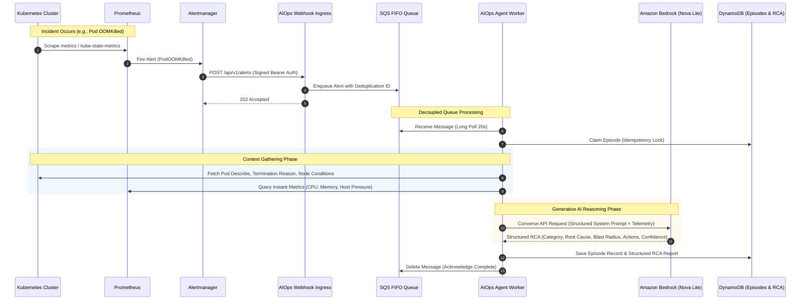

# Autonomous AIOps Reasoning Engine Architecture

## 1. Event-Driven Incident Lifecycle

The AIOps Assistant is an autonomous, event-driven site reliability engineering agent designed to investigate, diagnose, and synthesize actionable root cause analysis (RCA) for infrastructure incidents.

---

## 2. Key Resiliency & Reliability Mechanisms

### A. Strict Ingress Decoupling & Burstable Resiliency
- Rather than performing LLM inference synchronously during alert webhook processing, alerts are validated, stamped with an SHA-256 fingerprint, and placed into an **Amazon SQS FIFO queue**.
- This guarantees:
  - **Zero Alert Storm Drops**: Alert bursts do not exhaust pod HTTP worker threads.
  - **Deduplication**: Identical alert notifications received within 5 minutes share a message deduplication ID.
  - **At-Least-Once Delivery**: With redrive policy redirecting poisoned payloads to `boutique-aiops-alert-dlq.fifo` after 3 failed processing attempts.

### B. High-Precision Context Gathering
The agent collects deterministic, factual diagnostic data before engaging the generative AI model:
- **Kubernetes Events & Status**: Container exit code (e.g. `137` for OOMKilled), restart count, termination reason, pod events, node conditions (`MemoryPressure`, `DiskPressure`).
- **Prometheus Metric Sampling**: Scrapes exact memory usage bytes, memory limits, and node capacity via cluster-internal Prometheus API.

### C. Amazon Bedrock Converse API with Amazon Nova Lite
- **Model Selected**: `amazon.nova-lite-v1:0`
- **Latency**: Sub-4 second response time (measured 3.93s on live evaluation).
- **Cost Efficiency**: Incurs negligible fractions of a cent per incident compared to self-hosted models or large heavyweight models.
- **Safety**: Safe two-stage architecture: proposal generation is active (`AIOPS_REMEDIATION_ENABLED=true`), but autonomous direct mutation to `main` is strictly forbidden. Proposals require operator review and generate a reviewed GitHub Pull Request.
- **Idempotency**: All incident episodes and reports are indexed by deterministic hash in DynamoDB with a 30-day TTL.
