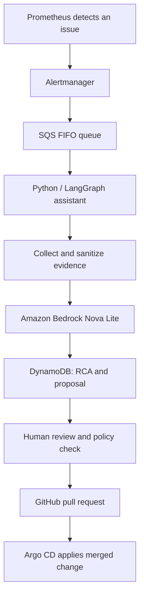

# AIOps Incident Pipeline

The platform used monitoring alerts and Amazon Bedrock to help an operator diagnose Kubernetes problems and approve safe configuration changes.

## Flow

## Why each service was used

- **Prometheus:** Read Kubernetes and application metrics.
- **Alertmanager:** Grouped alerts and routed notifications.
- **SQS FIFO:** Buffered incident messages for asynchronous processing. The queue supported ordered delivery and deduplication; this does **not** guarantee zero lost alerts.
- **LangGraph:** Organized diagnosis into eight steps, from input validation to a suggested fix.
- **Amazon Bedrock Nova Lite:** Produced a structured root cause analysis from sanitized evidence.
- **DynamoDB:** Stored reports and proposals for operator review.
- **Policy engine + operator CLI:** Restricted changes and required human approval.
- **GitHub and Argo CD:** Applied the approved manifest only after PR review and merge.

## Verified incident

The test canary was deliberately given insufficient memory and terminated with **OOMKilled, exit code 137**. A later approved proposal changed its request from `64Mi` to `256Mi` and limit from `128Mi` to `512Mi`. The first unsuitable proposal was rejected.

See [incident log](../terminal-outputs/09-aiops-oomkilled.txt), [rejection](../terminal-outputs/17-aiops-human-rejection.txt), [approval](../terminal-outputs/30-aiops-human-approval-pr.txt) and [GitHub PR #2](https://github.com/itsme-aarjav/autonomous-devsecops-platform/pull/2).

The AWS environment is no longer active; these are historical results.
