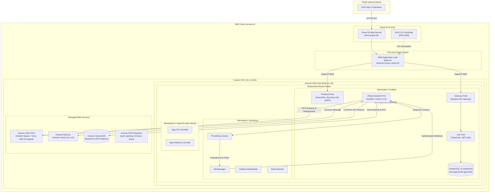

# Platform System Architecture

The **Autonomous DevSecOps & Cloud Operations Platform** is a cloud-native platform combining automated Kubernetes infrastructure, microservices workloads, full GitOps delivery, end-to-end observability, and an event-driven generative AI site reliability engineering (AIOps) assistant.

> [!NOTE]
> **Operational Status**: This architecture was historically deployed and fully validated on Amazon Web Services (AWS) in region `us-east-2`. Following complete verification, all project infrastructure was intentionally decommissioned to bring ongoing cloud costs to < $0.01/month.

---

## 1. High-Level Architecture Overview

---

## 2. Infrastructure Layer Breakdown

### A. AWS Network Foundation (Terraform Module: `vpc`)
- **Virtual Private Cloud (VPC) CIDR**: `10.1.0.0/16`
- **Subnet Layout**:
  - 3 Public Subnets (`10.1.0.0/24`, `10.1.1.0/24`, `10.1.2.0/24`) for Application Load Balancers and NAT Gateway egress.
  - 3 Private Subnets (`10.1.10.0/24`, `10.1.11.0/24`, `10.1.12.0/24`) for Kubernetes worker nodes, pods, and private endpoints.
- **Egress Architecture**: Single-NAT Gateway topology for development cost optimization with internet gateway routing.

### B. Amazon EKS Auto Mode Compute Foundation (Terraform Module: `eks`)
- **Kubernetes Version**: `v1.36.4-eks-cfb47f5`
- **Worker Node Hardware**: 3x `m7i-flex.large` (2 vCPU, 8 GiB Memory, Intel Xeon 4th Gen).
- **Operating System**: Bottlerocket OS (EKS Auto, Standard) 2026.10.31 with Linux kernel 6.18.
- **Node Automation**: EKS Auto Mode dynamically provisions, scales, and patches EC2 compute capacity without manual node group management.
- **Storage**: AWS EBS CSI Driver natively integrated via EKS Auto Mode with StorageClass `auto-ebs-sc` providing encrypted `gp3` storage with dynamic volume binding.

### C. Continuous Delivery & GitOps
- **Argo CD (`10.11.6` / app `v3.5.6`)**: Tracks git repositories and synchronizes Kubernetes manifests in real time.
- **Argo Rollouts (`2.43.9` / app `v1.10.2`)**: Enables progressive delivery and canary rollouts (50% → 100% traffic shifting) with automated rollback safeguards.

---

## 3. Microservices Topology

| Service | Language / Stack | Port | Base Image | Security Context |
| :--- | :--- | :--- | :--- | :--- |
| **boutique-frontend** | React 19 / Vite / Nginx | 3000 | Alpine Unprivileged | `runAsUser: 10001`, `runAsNonRoot: true`, `readOnlyRootFilesystem: true` |
| **boutique-gateway** | Node.js / Express | 3001 | Node 20 Slim | `runAsNonRoot: true`, drop capabilities |
| **boutique-auth** | Node.js / TypeScript | 3002 | Node 20 Slim | `runAsNonRoot: true`, drop capabilities |
| **boutique-postgres** | PostgreSQL 15 | 5432 | Postgres 15 Alpine (v15.19) | StatefulSet with 20Gi encrypted persistent storage |
| **aiops-assistant** | Python 3.11 / FastAPI | 8080 | Python 3.11 Slim | `runAsUser: 10001`, `runAsNonRoot: true`, `readOnlyRootFilesystem: true`, `dropCaps: ["ALL"]` |

---

## 4. Visual Architecture Evidence

The following visual proofs captured during live cloud operation validate the platform architecture:

1. [`01-storefront-ui-demo.png`](01-storefront-ui-demo.png): Live boutique e-commerce storefront UI at `https://demo.aarjav.site` with 8 seeded luxury products and active cart.
2. [`19-aws-vpc-resource-map.png`](19-aws-vpc-resource-map.png): AWS VPC Resource Map showing subnets across Availability Zones, route tables, IGW, NAT GW, and S3 Gateway Endpoint.
3. [`22-aws-alb-load-balancers.png`](22-aws-alb-load-balancers.png): AWS EC2 Console showing 3 active Application Load Balancers for Storefront, Grafana, and Argo CD.
4. [`23-aws-vpc-nat-gateway.png`](23-aws-vpc-nat-gateway.png): AWS VPC NAT Gateway (`nat-0f90877e6368c66d5`) with Elastic IP `3.12.199.177`.
5. [`25-aws-dynamodb-tables.png`](25-aws-dynamodb-tables.png): AWS DynamoDB Console showing the 3 on-demand AIOps tables (`episodes`, `rca-reports`, `remediations`).
6. [`26-aws-sqs-fifo-queues.png`](26-aws-sqs-fifo-queues.png): AWS SQS Console showing the 2 SSE-KMS encrypted FIFO incident queues (`alert-queue.fifo`, `alert-dlq.fifo`).
