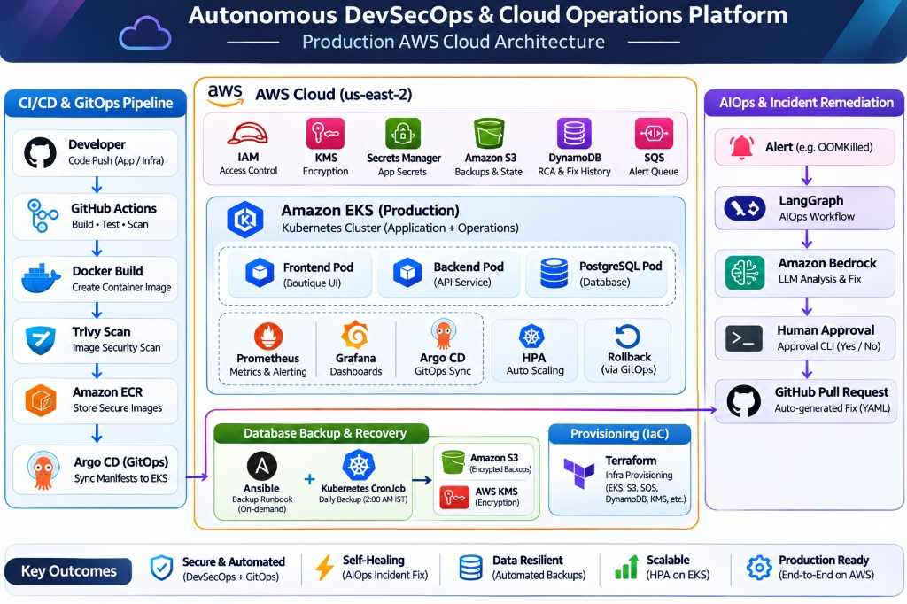

# System Architecture

This document explains how the project was connected during the **live AWS demonstration**. The cloud resources were intentionally removed after verification.

## Main components

## Cloud infrastructure

| Part | Historical implementation |
| --- | --- |
| Network | Custom VPC (`10.1.0.0/16`), four subnets across two Availability Zones, route tables, Internet Gateway and NAT Gateway |
| Kubernetes | EKS Auto Mode cluster `boutique-dev-eks` with Bottlerocket worker nodes |
| Ingress | Three Application Load Balancers for the application, Grafana and Argo CD |
| Database | PostgreSQL StatefulSet on an EBS `gp3` volume |
| Supporting services | ECR for images, S3 for backups and state, SQS for alerts, DynamoDB for incidents, KMS for encryption |
| Infrastructure as Code | Terraform with S3 remote state and native lockfiles |

## Deployment and incident handling

GitHub Actions validated, built and scanned images. While the cloud environment was live, the workflow published images to ECR and Argo CD synchronized Kubernetes manifests from Git. Prometheus and Alertmanager sent incidents to the AIOps assistant. The assistant proposed fixes for human approval rather than changing workloads directly.

Frontend progressive delivery was configured in Argo Rollouts with **50% and 100%** steps. The **OOMKilled canary test** was a separate workload used to prove incident remediation.

## Visual evidence

- [Application](01-storefront-ui-demo.png)
- [VPC](19-aws-vpc-resource-map.png)
- [ALBs](22-aws-alb-load-balancers.png)
- [SQS](26-aws-sqs-fifo-queues.png) and [DynamoDB](25-aws-dynamodb-tables.png)
- [EKS cluster](../kubernetes/20-aws-eks-cluster-info.png)
- [Complete AIOps flow](aiops-pipeline.md)
